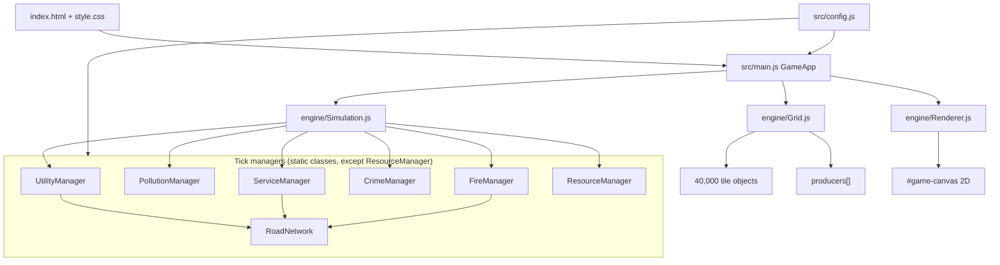
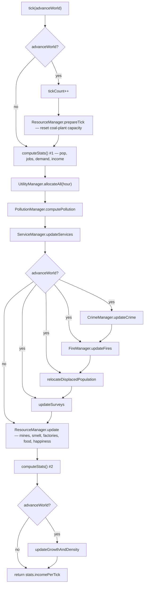
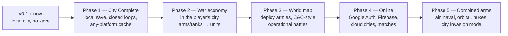

# SimConquer 2000 — Project Design Document

| Field | Value |
| --- | --- |
| Title | SimConquer 2000 — Architecture & Product Design |
| Author | TBD |
| Date | 2026-10-06 |
| Status | Living draft (rev 33) |
| Version covered | `APP_VERSION` `0.4.13` (`src/version.js`); current working tree |
| Intended in-repo path | `docs/DESIGN.md` |
| Repo | `g:\Repos\rts-web-game` (`origin`: `https://github.com/Havoc302/rts-web-game.git`) |
| Published snapshot | `simconquer2000/` — generated by `npm run build:prod`, never edited by hand |
| Working tree at inventory | Documentation is checked against the current implementation; uncommitted changes may exist. |

This is a **living** architecture + product document. It records the current implementation, outstanding Phase 1 work, and end-state product decisions: a hybrid of SimCity 2000, Command & Conquer, and a RimWorld-style world map, with Google identity and Firebase as the eventual online stack. Phase 1 remains a local city-builder slice. Full combined arms, world-map conquest, multiplayer, and Firebase are a **multi-year** roadmap, not the next two months of PRs. The `Current Phase 1 status` section below is the implementation-status authority; later roadmap/API sections describe intended design and are not evidence that a feature exists.

---

## Overview

Build & Conquer 2000 is a browser city-builder written in vanilla ES modules and Canvas 2D. The player zones a seeded 200×200 map, connects power/water/sewage over a road graph, funds civic services, and runs a tick-based economy of tax, labor, pollution, crime, fire, food, and industry. The current public surface includes paused-only JSON file save/load and a seeded planet map, but no city autosave, units, opponents, or victory condition.

The **product** is a hybrid of **SimCity 2000** (the city), **Command & Conquer** (the army fighting across a map), and a **RimWorld-style world map** (the strategic layer). The city acts like a real city: it provides the **money, industrial base, and people to supply its army**. That army is then used **across the world map** to conquer enemies. Online matches use **Google login and Google Firebase**. Two City Halls on one 200×200 city grid is **not** the end-state.

**Next engineering milestone is still city-complete (Phase 1):** local save/load, closed resource loops, tick hygiene, any-platform rendering. No login, no Firebase, no world map, no combat in that slice. The city *is* the economic engine for later war. Everything after that is a multi-year roadmap, sliced into PRs — not one “build C&C + Firebase + nukes” change.

---

## Background & Motivation

### Why this document exists

The repo grew from an initial city-sim into a multi-manager simulation. `AI-task-list.txt` remains the chronological AI handoff log, while this document is the architecture and product source of truth. The work log is intentionally operational: agents record intended work before generation and completed work plus validation afterward so interrupted tasks can resume.

This document exists to make the following boundaries explicit:

- New systems land by extending `Simulation.tick()` and `src/config.js`, with no stated module boundary for combat.
- Dead or transitional content (`PRODUCER_TYPE.POWER_PLANT`, military stockpiles, and future combat fields) is distinguishable from active Phase 1 behavior.
- Versioning is single-source through `src/version.js`, with `package.json` synchronization tested.
- Anyone joining the project could not tell city-only vs hybrid conquest (this document now records the hybrid).

### Current state (honest)

B&C2000 is a **single-player, client-only, paused-by-default city builder**. A session starts at the main menu with no world loaded; the player presses `New Game` to generate a random planet or `Load World` to import a save, then builds a city, opens the planet globe, and visits other seeded cities. Paused cities can be exported to JSON from the main menu and imported later; there is no localStorage city autosave, so refreshing without exporting still loses the session. Food, consumer goods, oil/fuel, agriculture, crime, fire, services, and military stockpile display are implemented; military production has no unit sink yet.

### Seeded Planet (0.2.5)

`OverworldMap` uses H3 resolution-two cells to cover the spherical planet with 5,882 connected hexes. The planet seed independently places six irregular continents and island chains; no Earth coastlines or fixed continent coordinates are used. Ocean hexes have no biome or city seed, except poleward of `CLIMATE_CONFIG.ARCTIC_CAP_LATITUDE`, where open ocean freezes into buildable Arctic ice. Land biomes form regional temperate lowlands, plains, hills, mountains, swamps, and deserts, and any land that reaches a polar cap becomes tundra; each land hex has a deterministic city seed. The first seeded continent supplies the home hex for moving an existing city when regenerating a planet.

Startup loads no world at all. The app boots to a blank background with only the main menu visible; the header bar, city HUD, build tools, and canvas chrome stay hidden until the player starts or loads a game. The main menu is the entry point and owns the audio on/off control, the getting-started instructions, a `Guided Tutorial` toggle button that shows its current state and sits beside the audio toggle, `New Game`, `Save World`, `Load World`, and `Close`. It can be reopened at any time from the Main Menu button in the world-map header. While a world is active, a `beforeunload` guard asks the browser to show its standard leave-site confirmation when the tab is refreshed or closed; browsers ignore custom wording, so the main menu also shows a visible reminder to use `Save World` first. The guard is disabled on the title screen and after game over, where the Restart button reloads intentionally. `New Game` asks for confirmation when the current world already has player progress (any placed road, zone, or building, a changed treasury, a visited hex, or outstanding debt); a pristine world starts without a prompt. When `Guided Tutorial` is switched on, pressing `New Game` starts the step-by-step instructions for the new world. No city is assigned, highlighted, or retained until the player selects a land tile and chooses `Open Map`; this generates that tile's seeded biome rather than starting in a mixed placeholder city. `New Game` itself builds only the planet: `this.grid` and `this.simulation` stay `null` until a hex is opened, so no 200×200 city map is generated in the background while the globe loads. Terrain is created lazily, and the city render loop stays idle until a map exists. `Save World` is disabled until that first city exists, because there is no map block to serialize. The tutorial begins with `Step 1: Select a map tile` and advances to roads after entering the selected map. The tutorial banner sits below the globe header so it does not overlap mobile tile details. Returning to a city is available only after selecting a map.

The World Map header also displays SimConquer 2000 and the current `APP_VERSION`, matching the city header. The title and branding wrap on narrow screens without overlapping planet-seed controls.

Displayed tile boundaries are spherical Voronoi polygons derived from the existing H3 cell centers using Three.js `ConvexHull`. This removes H3 projection-seam kinks and produces 5,870 convex hexagons and 12 convex pentagons with shared, gap-free edges. Surface fills, borders, selection outlines, and picking use the same displayed geometry. Logical H3 IDs, original boundaries, city seeds, biome assignments, and save data remain unchanged.

`OverworldView` renders the globe using Three.js and opens from the World button at the end of the top-bar speed controls, beside Mute. The globe header shows a Main Menu button at the far left beside the `WORLD MAP` title, then the shared treasury, then the `Edit World` control, then the music mute toggle at the far right. Players rotate and select land, enter a city generated on first visit, and return to visited cities with their state intact. Opening the globe pauses simulation and sets its speed to zero. The `Edit World` menu contains selected-tile and planet seed controls and reset/randomize actions; Save World and Load World live in the main menu. Choosing `New Game` from the main menu discards the current session (visited cities, treasury, and loans) and generates a brand-new random planet with a fresh home city seed, returning to the globe; choosing it again produces another whole new world. The selected-tile seed field follows the highlighted land hex; changing or randomizing it clears that hex's previous city state and lazily regenerates the selected city's map from its new seed. Changing the planet seed asks for confirmation, moves the active city to the new home hex, and removes previously visited cities. Version-2 JSON world saves include the planet seed, nullable active hex, every land hex's city seed, home city seed, and every other visited city snapshot. Importing a world save returns to the globe. Saving requires at least one opened city map, because the document always carries a city map block; world saves with a null active hex remain importable. Saves are gated on an exact build match, so a save written by any other version is refused rather than migrated. Terrain generation stays at version 2. Combat and world-map armies are still future work.

Map work is synchronous and the viewport reports it. The first world-map open imports Three.js, builds the 5,882-cell planet and its climate profiles, and constructs the globe geometry; opening an unvisited hex then generates that city's terrain, hidden ore, and first simulation tick. Both can take a noticeable moment on a slow device, so the canvas area shows a `Loading world map…` overlay while the globe is being built and a `Generating map…` overlay while a city map is generated, each with a spinner and a status label. The overlay is painted before the blocking work starts and stays up until the newly drawn city has been composited; revisiting an already-generated city switches immediately without it. Closing the globe also resizes and repaints the city canvas, so the first frame after a switch does not depend on the next animation tick. The UI does not add an artificial delay: generation is the same work as before, just reported.

New biome cities use biome profile 3: plains have sparse rocks, hills have larger rocky clusters, and mountains have large formations with less forest cover. Swamps generate 10-16 lakes with a 3.2x radius scale, up from 4-6 lakes with a 1.6x scale in profiles 1 and 2. Other biomes retain their profile-2 settings. The hex seed and biome both reach `Grid` on first entry. Saves record `map.biomeGenerationVersion` separately from the unchanged terrain generation version 2. Saves without that field regenerate using the original biome profile 1, and profile-2 saves retain the previous swamp settings, preserving terrain and hidden ore. Already-visited cities are not regenerated automatically. Resetting a city adopts the current biome profile.

Desert regions occupy seeded dry areas of continents and use sand-colored globe hexes. Desert cities have fewer rock clusters than plains, almost no forest, one or two small lakes, and no rivers. Desert cities also render their bare ground with a dedicated sand palette instead of the default soil palette, so the city map reads as dunes to match the globe. Desert changes do not alter the generation settings of other city biomes; existing visited cities retain their terrain.

Tundra covers the polar rings. Any land hex whose center sits at or beyond `CLIMATE_CONFIG.POLAR_CAP_LATITUDE` (72°) is tundra, overriding whatever regional biome the continent rules would otherwise assign, so a continent edge that reaches a pole turns white. The caps cover the 4.8% of the globe above that latitude, and because continents are placed independently of the caps some planets have few or no tundra hexes. Tundra cities are frozen pond country: no forest at all (so no wildfire candidates) and no rock shortage, but 3–6 small thermokarst lakes plus one river, all of it frozen. Frozen water is a distinct `ice` terrain: lakes are painted as ice end to end, while rivers keep an open centre lane and freeze only in patches along their banks (`ICE_CONFIG.RIVER_BANK_ICE_CHANCE`, limited to water tiles with at most `RIVER_BANK_MAX_WATER_NEIGHBORS` open-water neighbours). Ice is not water for placement: a Water Tower or Sewage Plant must touch open river water, so the player has to find an unfrozen stretch before the city can drink, and `getWaterfrontStatus` returns `null` beside ice, so a frozen bank also forfeits the clean-water growth and happiness bonus. Bridges cross ice and open water alike. Bare tundra ground is a hybrid: ordinary brown-grey soil with organic frost patches laid over roughly a quarter of it by a seeded value-noise field (`ICE_CONFIG.GROUND_PATCH_CHANCE`/`GROUND_PATCH_SCALE`), which is purely decorative — those tiles stay flat and buildable. Tundra hexes still render pale on the globe.

Arctic ice sheets cover the true poles. Poleward of `CLIMATE_CONFIG.ARCTIC_CAP_LATITUDE` (78°) every hex is `BIOME_TYPES.ARCTIC`, whether or not a continent reached it: open polar ocean freezes over and becomes ordinary buildable ground with its own city seed, while any land there loses its regional biome. The cap edge is not a latitude circle — a seeded, smooth three-wave field moves it by up to `ARCTIC_CAP_WOBBLE` (3.5°) at each longitude, so the sheet has an irregular, deterministic coastline (roughly 120 of the 5,882 res-2 hexes, about 2% of the globe) instead of a perfect ring. That band is where the seeded temperature spread stays below freezing all year, so Arctic precipitation is always snow. Arctic is visually distinct from tundra: a saturated pale blue on the globe and a bluer, glassier ground palette on the city map. Arctic cities are featureless: the Arctic profile zeroes forest clusters, rock clusters, lakes, rivers, and the hidden-ore spawn rate (`oreScale: 0`), so the sheet is 100% flat buildable ground with no trees, no mountains, no water, and nothing to survey (Survey Stations still place, but `canSurvey` refuses every Arctic tile). Arctic ice is solid water, so only water pumps and sewage plants skip the usual adjacent-water requirement and tap meltwater; every other water-hungry building still needs a river or lake. Arctic weather is the worst on the planet: an almost permanent overcast (`sunny` 2%, `cloudy` 63%, `rainy` 35%), a high wind mean, and a gale chance that periodically drives wind to the top of the scale.

Coastal cities are shaped by the hex they sit in. `OverworldMap.getOceanFacingDirections` inspects the six neighbouring H3 cells, snaps each ocean neighbour's bearing to the nearest of `N, NE, SE, S, SW, NW`, and returns those directions in that clockwise order (a pointy-top hex has no east or west edge). `Grid.generateCoast` then paints each ocean-facing edge as a half-plane on the square map: salt water 20-50 tiles deep with a strongly wobbling shoreline (`COAST_CONFIG.WOBBLE` 9 over an 11-tile lattice, so the beach front staggers in long sweeps and bays), a one-to-two-tile shore band, then ordinary terrain. Ocean edges that share a map side join into one continuous coast: `getCoastAnchors` adds that side whenever both of its corners are ocean (NW + SW flood the whole west side, NE + SE the east, NE + NW the north, SE + SW the south), while edges that are not neighbours stay separate. The shore is sand or rock in ordinary biomes, but an Arctic ice sheet has no sand and instead gets a broken shelf of ice (`COAST_CONFIG.POLAR_ICE_CHANCE`) and bare rock, so polar coasts are unbuildable and rely on the meltwater exemption for water and sewage. A deeper sea also means the 10-tile bridge limit now rules out bridging open ocean; bridges remain a river feature. Side edges use the matching map side and diagonal edges use the matching corner, so a hex with two ocean neighbours gets two bands and a one-hex island closes on all six edges plus its east and west vertices. Sand is buildable ground; rock beach is mountain rules. Rivers and lakes generate first and the coast paints over them, so rivers end in river mouths; a river's downstream end is always routed to an ocean-facing edge, the beach is never allowed to cap the channel (`carveRiverMouths`), and `orientRiverMouths` re-aims every mouth tile at the water it enters, so the end that meets the sea is always the outward end. `prepareCoast` computes the sea mask (and a distance field to it) before the river is traced, so a spring is never placed on a beach side or within `COAST_CONFIG.RIVER_SOURCE_MIN_SEA_DISTANCE` (50) tiles of salt water; on a small island where nothing is that far inland it falls back to the clearest point on the map. Mountains are painted before the river (`generateRockClusters` runs first and `paintRiverSegment` overwrites rock, so a channel cuts a valley through a range), which lets `collectMountainSprings` list each separate mass largest first and gives a hex with no land edge at all (a one-hex island, or a ring of coastline) a spring in the biggest range that clears the sea instead of an arbitrary inland point. The direction list is stored in the save's map block. Only the sea is salt: Water Towers need fresh water, but a Desalination Plant needs salt water, Sewage Plants may discharge into it, and its waterfront counts for happiness.

**River depth is two steps, and fords are rare.** Every tile carries `riverDepth`: `RIVER_DEPTH.DEEP` everywhere, `RIVER_DEPTH.LOW` only inside a natural ford, and only river water can ever be LOW (the sea and carved river mouths are reset to deep). After the channel is traced, `placeRiverFords` rolls `RIVER_FORD_CONFIG` on a *separate* PRNG stream (`SEED_SALT`) so adding fords cannot shift the river shape of an existing seed: 82% of city maps get none, 15% get one and 3% get two. A ford is not a stamp: `layFordBand` lays two or three gravel lanes beside the chosen path step and walks each one across the channel, wandering sideways as it goes, then turns a random share of the neighbouring water to gravel so the bar fades into the channel instead of stepping, which keeps every ford's silhouette seed-specific. Each lane runs from the middle of the channel to dry land, so the shallow water always joins both shores; a lane that runs into the sea, needs more than `MAX_SPAN` (6) steps, or a band that passes `MAX_TILES` (18) rejects the whole ford, so only drivable crossings are ever recorded. A ford is kept 8 steps clear of the spring and the mouth and 6 tiles inland of the sea, and a second ford only lands when the channel is long enough to keep them 24 steps apart. Fords are the only river tiles a future vehicle will cross without a bridge (`Grid.isFordTile`). They render as lighter water with a gravel bed and riffles instead of deep-water chevrons, the inspector names them `Fresh Water — shallow ford`, and polar rivers leave them unfrozen so the crossing survives winter. Verified by `tests/cases/river-fords.case.js`, which checks that every sampled ford touches the bank on both sides of the channel, that its patch is one connected bar within the tile cap, and that no two fords share a silhouette.

Every land hex has a deterministic climate profile keyed by the planet seed and H3 cell ID, independently of its editable city-map seed. Latitude sets the broad temperature gradient from the equator to the poles, where the cold is concentrated in the caps: the fall is weighted by `CLIMATE_CONFIG.LATITUDE_GRADIENT_POWER` (1.6) so the torrid and temperate bands keep their warmth while the polar caps reach a `POLE_TEMP` of -40 °C. Biome and small seeded variation tune the local mean, range, and sunny/cloudy/rainy chances; tundra land is both much colder and drier than the temperate bands, and Arctic is colder and far cloudier still. Every hex also adds its own seeded jitter to the wind mean, and biomes with an explicit weather mix (Arctic) jitter their cloud/rain split and gale chance too, so two hexes of the same biome never share an identical forecast. Each profile carries a wind mean and gale chance that blend with the six-cell neighborhood like temperature, so blustery Arctic raises wind on nearby hexes. The immediate six-cell neighborhood gently blends base temperature and moisture tendencies, so neighboring deserts make temperate hexes slightly hotter and drier without changing their biome. Ocean neighbors contribute moisture. When a city is active, its single weather manager samples persistent condition intervals using those chances and temperature fluctuates around the cell's mean with a bounded bell-shaped distribution; wind runs in short 3-8 tick windows pulled toward the climate wind mean, and gale-prone climates occasionally aim for the top of the scale instead; at or below `TEMPERATURE_CONFIG.FREEZING_POINT` the label reads `Snowing` rather than `Raining` and the precipitation overlay draws pale flakes. The weather tooltip's Conditions line names only the sky and wind; the dedicated Temperature row shows whole degrees (the simulation itself keeps full precision). Only active cities advance weather; saves retain current conditions and the remaining weather interval. Climate profiles regenerate from the world seed and cell identity.

Hot and cold weather cost money and mood. `TEMPERATURE_CONFIG` defines a comfort band of 10-35 °C. Outside it, every tile and building that draws power pays a load multiplier of `1 + excursion / 20`, where the excursion is the distance to the nearest band edge. That doubling point is not a ceiling: the multiplier keeps climbing linearly, so a -40 °C polar city draws 3.5x its mild-weather power and a city sized for a temperate climate can brown out in a freeze or a heatwave. Water and sewage demand never change with the temperature. Happiness loses a capped 0.5 per degree of excursion, reaching its 10-point maximum 20 °C outside the band; past that it is simply cold and there is no more mood left to lose, which is why a deep freeze and a heatwave cost the same. This is deliberately separate from the medical rule, which still treats anything below 5 °C or above 35 °C as a health exposure. The weather tooltip reports the current power load as a percentage so a demand spike is visible.

Temperate is the explicit unmodified base biome: normal forest and rock cluster counts and sizes, 0-5 lakes at normal size, and mixed river layouts. For the same seed and generation profile, Temperate produces exactly the same terrain, river flow, and hidden ore as the biome-unspecified base generator. A seeded direction splits available cooler continental lowlands into grouped Temperate and Plains regions, rather than assigning all cooler lowlands to Temperate and confining Plains to the equator. Plains remains a separate, more open biome, shown in light green; Temperate uses darker green. Existing visited cities retain their generated terrain.

Selecting a land hex shows its city-map water, forest, and mountain coverage as percentages of all city tiles, with water including both rivers and lakes. Only maps that already exist are measured: the active city and other visited cities. An unexplored hex shows `—` for those rows until the player chooses `Open Map`, because generating a preview would build the full 200×200 city map before the player asked for it. Ocean hexes have no city terrain stats.

The land-tile action is labeled `Open Map` for current, visited, and unexplored tiles. Small bordered markers identify land maps with at least one player-built road, including bridges and tunnels. Markers refresh when the world map opens and follow globe rotation. Generated or visited maps without roads remain unmarked, including the current map. Removing the last road removes the marker even if zones or buildings remain; oceans are never marked.

### Pain points

1. **Standalone JSON save/load is sparse and seed-regenerated.** Saving is available only while paused and importing restores the game paused. `SAVE_VERSION` 2 stores seed, dimensions, biome, and a terrain generation version, then sparse tile overrides and producers. Sparse maps still carrying terrain generation version 1 regenerate with the original circular cluster algorithm; version-2 maps use irregular clusters. Re-saving a version-1 map retains generation version 1 until the map is reset, which adopts version 2. Unsupported future generation versions are refused rather than rebuilding the wrong map, and the save format itself is gated on an exact build match.
2. **`Simulation.tick` remains a large orchestrator.** Its pause/preview semantics are now explicit and tested, but named stage extraction is still outstanding.
3. **Military production has no unit sink.** Arms and tanks are visible stockpiles, but barracks, vehicle depots, units, and world-map deployment are later phases.
4. **Emergency coverage now uses cached direct/road/road-side sets.** Browser-level interaction and visual validation remain limited; see the test gaps below.
5. **Canvas 2D on a 200×200 / 32px map** uses active tile registries, pollution dirty gating, cached stats aggregates, chunked terrain, and bounded HUD/inspector updates. A reporting-phone run at 1x, 2x, and 5x confirmed the city stays responsive after those stages.
6. **UI and renderer behavior has limited automated coverage.** HUD snapshots, inspector signatures, and terrain-chunk invalidation now have Node tests; browser interaction and visual behavior remain mostly manual checks.

---

## Goals & Non-Goals

### Product goals (decided)

- **Hybrid fantasy:** SimCity 2000 city + Command & Conquer conquest + RimWorld-style world map. The city supplies **money, industry, and people**; the army fights **across the world map**.
- **Two map scales:** the existing **200×200 city grid** (tactical/city layer) and a new **world map** (strategic layer: regions/settlements). The city map is one faction’s city, not a dual-City-Hall battlefield.
- **Online:** Google identity + Firebase for accounts, cloud cities, and later matches. Local saves remain the Phase 1 and fallback/dev path.
- **Victory:** complete destruction of an enemy civilisation (invasion, late-game nukes, or orbital bombardment) **or** destroy all military assets and **capture City Hall** — capture takes **quite some time** so the defender can intercept. Sandbox remains a mode, not the victory design.
- **Full combined arms** as the roster destination (multiple infantry, light tanks, MBTs, artillery, missiles, ships, helicopters, planes, satellites, orbital weapons, tactical and strategic nukes), **phased** so the first combat slice is infantry + tanks only.
- **Any-platform:** easier on a large screen, **must be playable on mobile**. Chunked terrain cache is required before city-complete is “shipped.”
- **Google Fonts + system fallback.** The game is online; no self-hosting required.

### Phase 1 goals (next, local)

- Keep a **playable city-builder** on the 200×200 grid with the current stack (`npx serve .`, vanilla ES modules, Canvas 2D, Node assert tests).
- Treat `src/config.js` as the **balance source of truth**.
- **Persist cities** as versioned JSON. Paused-only file export/import is implemented; localStorage autosave and its boot precedence remain outstanding.
- **Close civilian resource loops** so food, goods, coal, oil/fuel, and bars have producers and sinks. Arms/tanks stay stockpiled and **visible**.
- **Decompose the tick** into named stages (extract-method).
- Procedural canvas art through city-complete; sprites optional later.

### Current Phase 1 status

Implemented; automated coverage is listed below, with browser-level gaps called out separately:

- Pause-safe placement previews, treasury accounting, famine recovery, agriculture occupancy, resource consumption, fuel/refining, crime, fire, civic staffing, mobile input/layout, wind/solar/battery connectivity, version synchronization, chunked terrain rendering, and bounded HUD/inspector updates.
- Unified test execution through `npm test`; all 46 test files pass.
- Residential, commercial, industrial, and agricultural zone tiers can be upgraded at any time from the inspector; full tiles below high density show the corner capacity marker, and output scales with the higher density's job slots and population capacity.
- Global Finance: treasury and loan ledger are shared across visited cities, whose economies tick together; loans amortize over 720 ticks and loan-backed game over checks combined population across all cities. A negative treasury pauses the world and forces a loan or a bankruptcy declaration.
- Road maintenance budget and deterioration: underfunded road tiles are randomly selected for 10% damage per tick; destroyed roads leave the active network and sever utilities/pathing unless an alternate route exists.
- Versioned sparse city JSON export/import, seeded planet/world saves, the survey overlay and survey expense/cancellation flow, and School/University education tax bonuses are implemented.
- City saves are manual file export/import only. A city autosave and autosave-based startup/restore flow are not implemented.

### Simulation performance

`Grid` maintains active registries for zones, roads, fire candidates, active fires, and repairing tiles. Simulation, utility allocation, services, road-network zone discovery, resources, crime, fire processing, relocation, and road maintenance use those registries instead of repeatedly scanning all 40,000 tiles. Save import rebuilds the registries from restored tile state.

A timed 200×200 50-tick soak, before the later cache stages, spent about 9.04 ms/tick on the measurement machine. The slowest stages were `computeStats` (stats-before + stats-after, ~4.58 ms, more than half of tick time) and pollution (~3.36 ms). Utilities and fire were ~0.46 ms each; remaining stages were ≤0.10 ms.

Caching rules now in force:

- **Services.** `ServiceManager.updateServices()` skips coverage/assignment unless service buildings, road topology, staffing, operational state, or service budgets changed. Staffing and running costs still update when population or workforce changes.
- **Pollution.** After utility allocation, a dirty/state-signature gate recomputes only prior affected tiles plus current source radii. `Grid.pollutionSum` / `Grid.pollutionMax` refresh during that recompute and during `rebuildActiveTileSets()`. Stable ticks reuse the last pollution field.
- **Stats.** `computeStats()` reads those pollution aggregates plus `activeZonedTiles` / `activeRoadTiles` instead of scanning all 40,000 tiles. Placement, bulldoze, fire, density changes, and save import keep the same totals as a full scan.
- **HUD / inspector.** `UiRefresh` snapshots skip unchanged DOM fields. Coarse-pointer mobile layouts also bound HUD/inspector refreshes to `RENDERER_CONFIG.HUD_MOBILE_CADENCE_MS` (500 ms). User actions force an immediate refresh. Simulation ticks always run first.
- **Terrain cache.** 64×64 offscreen chunks, viewport blit only. `Grid.markTerrainChanged()` rebuilds dirty chunks once per frame. Overlay mode paints visible tiles only and does not invalidate chunks. Map regen and save import rebuild the full cache.

`?debugTiming=1` enables `Simulation.enableTiming` and `Renderer.enableTiming` and logs averages every 120 frames. A reporting-phone run at 1x, 2x, and 5x confirmed the city stays responsive after these stages.

### Mobile Performance Plan

Do not make another broad performance refactor without timing evidence. The staged pass is complete:

1. Cache service assignment/coverage work when its inputs are unchanged.
2. Track polluted and water-polluted tiles so pollution recalculation clears and recomputes only affected areas.
3. Incrementally maintain stable-map aggregates rather than rescanning the full grid twice per tick.
4. Measure and bound browser render, HUD, and inspector work separately from simulation.

Inspector regressions found during that pass are also closed: utility producers show their actual connected/serviced state, and producer load/capacity values use two decimal places.

Correctness remains the constraint: river direction, utility shortfalls, fire repair/destruction, population growth, save import, and HUD totals must remain equivalent after every optimization. The staged implementation checklist and validation commands live in `AI-task-list.txt`.

Outstanding implementation work:

- LocalStorage city autosave and autosave boot precedence, as specified in the persistence design below.
- Browser-level validation of JSON save download/import.
- Named tick-stage extraction (`stagePrepare` / `stageUtilities` / …).
- Stronger browser-level UI/touch validation.
- Military unit production and world-map systems remain later phases, not Phase 1 blockers.

### Phase 1 non-goals (not product non-goals)

- **No Google login, no Firebase, no match clock** in Phase 1. Those are later phases.
- **No world map, no C&C combat, no nukes/orbital** in Phase 1.
- **No React / bundler / TypeScript / engine rewrite** as a prerequisite.
- **No Starcraft-style free-moving RTS micro** on the city grid.
- **No rewrite of the road BFS** as a condition of later combat.
- Treat historical `Current task` entries in `AI-task-list.txt` as log records, not active work; use its `Open handoff` section and this document's current-status section.
- **Do not put two City Halls on one 200×200 city grid.** Each city is one faction’s grid; armies meet on the world map. Invasion of a city grid is a later mode.

---

## Current Architecture

### Runtime topology

Entry is `index.html` → `src/main.js` (`GameApp`) → `Grid` + `Simulation` + `Renderer`. There is no bundler. Tests are Node ESM scripts using `assert`.



`GameApp` owns one **world-wide treasury**, **loan ledger**, **game-over state**, active tool, input, and sim interval. Each visited city keeps its own grid, `Simulation`, stockpile, and stats; all visited city simulations advance together on each active world tick and settle income/expenses against the same treasury. Opening the globe pauses that shared clock but continues to show the world treasury. Switching cities never switches wallets or loans.

### Stack and numbers

| Item | Value | Source |
| --- | --- | --- |
| Map | 200×200 tiles (40,000) | `MAP_WIDTH` / `MAP_HEIGHT` |
| Tile size | 32 px → 6400×6400 world pixels | `TILE_SIZE` |
| Money scale | Pre-scaled monetary constants; no runtime multiplier | `src/config.js` |
| Crafting recipes | One central table for both recipe stations | `src/recipes.js` |
| Starting treasury | `$25,000` (`2500 * 10`) | `STARTING_TREASURY`; HUD seed text in `index.html` |
| Tick wall-clock | `4000 / speed` ms (`1x=4s`, `2x=2s`, `5x=800ms`) | `GameApp.setSpeed` |
| Clock | 1 tick = 1 in-game hour, 24-hour day, day 06:00–18:00 | `TICKS_PER_HOUR`, `DAY_START_HOUR`, `NIGHT_START_HOUR` |
| Zoom | 0.4–2.5, default 1.0; low-detail below 0.7 | `RENDERER_CONFIG` |
| Terrain cache budget | 1,200 tiles/frame while building | `RENDERER_CONFIG.TERRAIN_BUILD_BUDGET` |
| Terrain chunk size | 64 tiles (2048 px, under a 4096 GPU cap) | `RENDERER_CONFIG.TERRAIN_CHUNK_TILES` |
| Mobile HUD cadence | 500 ms on coarse-pointer layouts | `RENDERER_CONFIG.HUD_MOBILE_CADENCE_MS` |
| Dev | `"dev": "npx serve ."` | `package.json` |
| Version | `0.2.20` from `src/version.js`, synchronized with `package.json` and cache-busting consumers | `tests/cases/version-sync.case.js` |
| `config.js` | 690 lines total (~637 non-blank) | file |
| `Renderer.js` | 897 lines | file |

### Tick pipeline (the heartbeat)

`Simulation.tick(advanceWorld = true)` in `src/engine/Simulation.js`:



`GameApp.simTick()` (interval, only while unpaused) applies treasury:

```text
treasury += incomePerTick - serviceExpenses - roadExpenses - utilityExpenses - surveyExpenses
```

Placement success (`handleCanvasClick`) currently:

```js
this.treasury -= cost;             // construction purchase
this.simulation.tick(false);       // refresh preview state; no economic/world tick
```

While paused, placement uses `tick(false)`: world state, resource production/consumption, famine loss, and `tickCount` do not advance, while preview utility allocation and stats refresh the HUD.

**Intended pause/treasury semantics (Phase 1, decided):**

- **`simTick()` is the only path that mutates treasury for income and expenses.** Construction still does `treasury -= cost` on successful place (a purchase, not a sim tick).
- Placement always calls `tick(false)` to refresh utilities/HUD. It never calls `tick(true)`, never does `treasury += income`, and never subtracts service/road expenses.
- **`tick(false)` is a preview:** it must not persist wind `capacity` or battery `storedEnergy`. `allocateAll` runs in preview mode (see Key Decision 13): recompute `usedCapacity` and HUD demand from the last advancing tick’s persisted generation/storage; do **not** call `updatePowerGeneration` (no wind reroll), `settleBatteries`, or `chargeBatteries`. Do **not** run `prepareTick` on the paused path (that write sets `coal_plant.capacity = coalCapacity` and would un-starve a fuel-empty plant).
- Gate `ResourceManager.update` and `populationLoss` on `advanceWorld`.
- Do **not** “align” placement with `simTick` expenses: that would charge a full economic tick per painted road tile.

### Map and terrain (`Grid`)

`Grid` (`src/engine/Grid.js`) is the spatial source of truth.

- **PRNG.** `createPRNG(seed)` is a Mulberry32-style generator. It falls back to `TERRAIN_GENERATION_CONFIG.DEFAULT_RANDOM_SEED`, which **is not defined** in `config.js`. `parseInt(undefined, 10)` is `NaN`; `NaN || undefined` is `undefined`; `undefined ^ 0x6d2b79f5` ToInt32-coerces to `0` then XOR. Invalid seeds therefore all share the **same** stream (seed 0 XOR constant), they do not “hash `undefined`.”
- **Seeded vs unseeded RNG today:**
  - Seeded (`this.random` / `createPRNG`): terrain, rivers, lakes, forests, rocks, hidden ores; crime **tile sampling** (`CrimeManager.sampleRandom(..., grid.random)`).
  - Unseeded (`Math.random`): wind capacity swing, fire ignition and spread, crime incident spawn and police response rolls, the initial random seed pick in `getInitialSeed`.
- **Seed sources, in order:** `?seed=` URL param → `localStorage.bc2000_map_seed` with one-time legacy read of `metropolis_map_seed` → random in `[100000, 9100000)`. Reset/regen writes the current key and URL.
- **Generation order** (`generateProceduralTerrain`): rivers (simple 40% / fork 30% / merge 30%) → 0–5 standalone lakes → forest clusters scaled by map area → rock/mountain clusters. Version-2 lakes, forests, and mountains vary their radius by seeded angular lobes and smaller indentations, retaining the original per-tile edge wobble; the shapes extend beyond the former circular bounds. Rivers retain their separate flow generation. Version-1 generation keeps its original loop bounds and PRNG draw order for save compatibility. All terrain generation uses `this.random`, not `Math.random`.
- **Hidden ores.** `generateHiddenOres` rolls `ORE_GENERATION` per terrain (mountain 35%, flat 3%, forest 1.5%, water 1%) and then picks an ore by `ORE_CONFIG` `spawnWeight`: iron and coal 20, bauxite 16, copper 14, oil 12, uranium 8, titanium 6. Weighting keeps common metals common while titanium stays a rare find. Sand is deliberately not an ore: it is not rolled, not surveyed, and the Sand Quarry needs no deposit.
- **Tile schema** (`createDefaultTile`): terrain, road/bridge/tunnel flags, zone, density, growthScore, industrial `recipe`, population bookkeeping (`relocatedPopulation`, `fireDisplacedPopulation`, `populationLoss`), producer pointer, utility shortfall/distances, pollution, ore/survey fields, crime, fire, `destroyed`. No `ownerId`. No visibility field.
- **Placement rules.**
  - Roads: flat, not destroyed, no road/zone/producer.
  - Bridges: water tiles; set `hasRoad` + `hasBridge`.
  - Tunnels: mountain tiles; set `hasRoad` + `hasTunnel`. Cost `$1,000`.
  - Zones: flat, road-adjacent, empty. Residential/commercial `$200`; industrial/agricultural `$300`.
  - Producers: water-adjacent where required (nuclear, water pump, sewage); ore-match for mines/derrick (mines allowed on non-water terrain, including mountains); unique City Hall; windmill/solar require an 8-neighbor battery **at placement**.
  - Survey: one idle operational road-adjacent Survey Station, 10 ticks standard / 20 mountain. An exposed mountain is surveyable normally; a mountain with all four orthogonal neighbors also mountainous requires an adjacent tunnel for access.
  - Bulldoze `$50`: clears zone/road/bridge/tunnel/producer, converts forest to flat (bumps `terrainVersion`), and can un-destroy a burnt tile.

### Camera and input (`GameApp` + `Renderer`)

- **Desktop camera pan is right-drag.** Touch: single-finger drag always pans (never drag-builds). The Pan tool does **not** left-drag the camera; its left-click/drag selects tiles (same path as Inspect).
- **Desktop left-drag** calls `handleCanvasClick` on every move for **any tool except Inspect**, including producers — not only “repeatable” tools. Inspect is click-to-select only (no paint-drag).
- **Zoom.** Wheel, cursor-centered (`RENDERER_CONFIG.ZOOM_MIN/MAX`).
- **Touch tap-to-build** after `< 8px` movement.
- **Mobile.** `matchMedia('(max-width: 820px) and (hover: none) and (pointer: coarse)')`. Off-canvas tool/HUD drawers, safe-area offsets, auto-switch to Pan after placing a `producer_*` only.
- **Renderer.** Viewport culling; 64×64 offscreen terrain chunks with viewport blit; dirty-tile incremental rebuilds via `Grid.markTerrainChanged()`; overlays paint visible tiles only and do not invalidate chunks. Night tint `NIGHT_TINT_ALPHA = 0.35`; low-detail path under zoom 0.7 (and 33 ms throttle). Overlay picker: power, water, sewage, pollution, crime, survey, police, fire, hospital.

Art is 100% procedural canvas (houses, fields, spinning windmill blades, battery fill, river chevrons, fire flicker). Mines, warehouses, smelter, silo, oil derrick fall through to a generic colored rect + 5-letter label in `renderProducerTile`.

### Zoning, growth, labor, tax

**Zones** (`ZONE`): residential, commercial, industrial, agricultural. Densities are light, medium, and high. Growth-score thresholds 10 and 25 define residential occupancy bands, with a cap of 50; they no longer promote density automatically. Density never downgrades.

**Manual zone tier upgrades (implemented):** Upgrades are available at all times; reaching full occupancy is no longer a prerequisite. Full zones below high density display the small corner marker so the player can see that a tile is at capacity and still upgradeable; high-density tiles are at the maximum tier, so they never draw that marker. Clicking the tile in Pan mode opens the inspector, where non-high-density zones offer an Upgrade action. Upgrade prices are the zone's base placement cost ×2 for light → medium and ×4 for medium → high; the action is disabled when the treasury is insufficient. Base zone prices are residential/commercial `$200` and industrial/agricultural `$300`. Density raises employment and residential capacity, and agricultural food yield/building output scale with those job slots.

**Residential population** (`computeTilePopulation`): linear in growth score within the current density band, capacity `25 / 125 / 500`. No free population at growth 0.

**Demographics** (`DEMOGRAPHICS_CONFIG`, Australia-inspired): school-age 16%, retirees 17%, workforce 52%. `splitDemographics` is a static split of current population — there is no aging sim.

**Jobs.** Commercial/industrial/agricultural job slots come from `jobsProvidedFor`: workforce share of residential capacity, split 40/40/20 C/I/A, normalized to the largest share.

| Density | R cap | C jobs | I jobs | A jobs |
| --- | --- | --- | --- | --- |
| Light | 25 | 13 | 13 | 7 |
| Medium | 125 | 65 | 65 | 33 |
| High | 500 | 260 | 260 | 130 |

City-wide `employmentRate = jobsFilled / totalJobsProvided` (a **vacancy-fill ratio**, not resident unemployment). Filled jobs on C/I/A tiles are `round(totalJobs * employmentRate)`. High tax above 50% shrinks job slots by up to 50% (`MAX_HIGH_TAX_JOBS_REDUCTION`).

**Tax.** Slider 0–100% (`LABOR_TAX_GROWTH_CONFIG`). Revenue:

```text
income = ((population/100) + (jobsFilled/100)) * $10 * (taxRate/100) - crimeTaxLoss
```

`BASE_INCOME` was removed. `industrial-economics.test.js` checks industrial/agricultural zone cost and equality of industrial/commercial job tables; it does not assert tax revenue. Growth modifier is continuous: bonus below 40%, negative at 50%, quadratic outflow toward 100%. Residential growth **stalls** (`delta = 0`) if any workers are unemployed or if the city has zero workplaces.

**Treasury** lives on `GameApp`, not `Simulation`. Fully funded road maintenance is `$1` per active road/bridge/tunnel tile per tick (`ROAD_MAINTENANCE_COST = 1`). A road maintenance budget below 100% reduces expense proportionally and rolls a share of the network equal to the missing budget for wear: 99% funding rolls one tile per hundred road tiles, 50% funding rolls half of them, and each rolled tile has a flat 5% chance (`ROAD_MAINTENANCE_CONFIG.DAMAGE_ROLL_CHANCE`) of taking one hit of `DAMAGE_PER_HIT = 10`. Road tiles degrade from 0 to 100, so a tile is worth ten hits. Wrecked tiles leave the active road and pathing registries and stay as rubble until the player bulldozes the tile and rebuilds it. Restoring the budget to 100% repairs one damaged tile per tick, worst damage first, until every standing road is pristine again. Every power generator, battery, water pump, and sewage plant costs `UTILITY_OPERATING_COST = $2` per tick (`stats.utilityExpenses`, ⚡ HUD chip), whether or not it is connected. Monetary values are pre-scaled constants. Pensions are folded into `serviceExpenses`.

**Loans (implemented in `0.2.7`):** Players may borrow `$1,000`, `$2,500`, `$5,000`, `$7,500`, `$10,000`, `$15,000`, or `$20,000`. Each loan is amortized over 720 hourly ticks. Its fixed total-term interest rate is set at origination from the arithmetic mean happiness across all visited cities, including the active city: 2% at mean happiness 100, rising linearly to 20% at mean happiness 0; the equivalent per-tick rate compounds against the outstanding balance. **Debt risk surcharge (`0.3.9`):** every loan already outstanding adds 10 percentage points to the next loan's rate (`RISK_PREMIUM_PER_LOAN`), so the first loan at 50 happiness costs 11% and the fifth costs 51%; the rate is capped at `MAX_TOTAL_INTEREST_RATE` (100%). Both the finance panel and the emergency-loan modal preview the resulting rate and show the current risk premium. A scheduled payment is deducted only when the shared treasury can cover it; missed payments capitalize that tick's interest, and once the term's tick counter reaches zero the entire remaining balance becomes due every tick, so a loan that still cannot be paid keeps growing until the treasury can clear it. Treasury and loans are global across all visited cities, whose economies tick together and settle against one wallet; the globe pauses the shared clock while showing the same balance. Outstanding loan debt with zero combined population across cities pauses play permanently with `Game over, all your people left`; the game-over screen offers a Restart action that reloads into a fresh session.

**Forced insolvency choice (implemented in `0.3.8`):** When a world tick leaves the shared treasury below zero (`isInsolvent`), the game pauses immediately and a modal blocks play until the player either takes a loan or declares bankruptcy. The modal shows the negative treasury, outstanding loans, next scheduled payment, and a live interest/payment preview for the selected principal; borrowing from it uses the same loan terms as the finance panel, and if one loan does not cover the deficit the modal stays up so the player can borrow again. Speed controls refuse to resume while insolvent, and spending is already blocked by the per-item treasury checks. Declaring bankruptcy is confirmed, ends the run, and opens the game-over screen with a `Bankrupt` title; the run type round-trips through saves. Loading a save with a negative treasury reopens the forced choice.

**Road maintenance budget (implemented):** The Service Budgets tab has a 0–100% Road Maintenance slider, persisted with city saves. Each world tick funds a percentage of active road tiles; randomly selected uncovered tiles gain 10% road damage. A road reaching 100% damage is destroyed, removed from `hasRoad` / bridge / tunnel state and the active-road registry, and increments `coverageVersion` so utilities and cached route/pathing queries stop using it. Alternative connected road routes remain usable. Road damage uses the existing tile health-bar treatment. Older saves default to 100% road funding and zero road damage.

**Build info operating costs:** one tick is one in-game hour (`TICKS_PER_HOUR = 1`). All power generators, batteries, Water Pumps, and Sewage Plants display their flat $2/hour charge. Survey Stations show $0/hour idle and $10/hour during a survey. Civic services show tier 1 / 2 / 3 maximum hourly costs at full staffing and 100% budget, calculated using the same `ServiceManager.getOperatingCost` formula as live expenses (actual staffing, operational state, and budget can lower the charge). City Hall and the Oil Refinery have no configured direct cash running cost, shown as $0/hour; the refinery still uses oil as an input.

### Utilities and day/night

`UtilityManager.allocateAll` (`src/engine/UtilityManager.js`):

1. `updatePowerGeneration(hour, weather)` — wind output follows wind intensity and its tier peak; solar follows the 06:00–18:00 bell curve, cloud efficiency and its tier peak; battery discharge is capped at `min(maxStorage / 10, storedEnergy)`.
2. Allocate live renewable power through each adjacent road-connected battery first, with no battery discharge-bandwidth cap on this pass; then allocate battery storage to remaining zone demand, then dispatchable power plants.
3. Allocate **water** nearest-first; **sewage** farthest-first (`descending`) so distant tiles back up first. `allocateUtilityConsumers` then allocates power/water/sewage to every producer with `utilityUsage`; water pumps and sewage plants use their tier-scaled draw. If any zoned tile or producer still has unmet power demand, rerank all power consumers (zones, pumps, sewage plants, Survey Stations, civic services, etc.) together by shortest road distance to a generator and reallocate once. On equal distances, producers win ties. This runs only on an actual shortfall, including disconnected networks that can hide behind surplus citywide capacity. Apply producer outage grace once after final allocation: five failed ticks (`UTILITY_FAILURE_GRACE_TICKS`) before `operational = false`. Generation capacity itself is **not** gated on `operational` (intentional, to avoid cascade blackouts).
4. `settleBatteries`, then charge each adjacent road-connected battery from unused wind/solar output; charge batteries from unused dispatchable generation afterward, accounting for producer power use. Road-network maps are cached across stable ticks and invalidated on topology, connection, or map regeneration; live capacity and demand are still checked each tick. Fire/police coverage sets cannot substitute for this routing because they are radius-based and do not track generator capacity.

Zone utility demand is `USAGE_RATES[zone][density] * occupancyRatio`. Occupancy is implemented for residential, commercial, industrial, and agricultural tiles. Empty capacity contributes no demand; filled agricultural jobs contribute utility demand according to the agricultural usage table. The power-demand HUD meter includes baseline producer/civic consumption and active Survey Station draw as well as zone demand, so the displayed total reflects consumers competing for power.

Windmills and Solar Panels are passive generators. They require an adjacent Battery Storage tile at placement and that battery must be road-connected to contribute to the grid; neither the renewable nor the battery's own utility status gates renewable generation. Connected renewable output passes through the battery to live grid demand without the battery's stored-energy discharge cap; the cap applies only when stored energy covers a deficit. Renewables produce no direct utility demand, staffing, water, or sewage usage. The Tile Inspector reports this as a battery-mediated connection rather than a missing local road.

Water Pumps and Sewage Plants are tiered like the other service buildings. Tier capacities are 120 / 240 / 480. Their ladders are anchored at the original building price for the top tier: $930 / $1,670 / $3,000 for pumps and $1,230 / $2,220 / $4,000 for plants (each step 1.8× the next-lower tier, rounded to the nearest $10). Reaching tier 3 costs $5,600 for a pump and $7,450 for a plant in total. Their power and cross-utility draw doubles with each tier (a tier-3 pump draws 8 power and 4 sewage; a tier-3 plant draws 8 power and 4 water), so upgrading does not create a free-efficiency loophole. The flat $2/tick utility operating charge is unchanged.

Windmills, Solar Panels and Battery Storage are tiered. Tier peaks are 16 / 32 / 64 for wind, 15 / 30 / 60 for solar, and 100 / 200 / 400 storage for batteries (discharge is always one tenth of storage per tick). The price ladders are $500 / $900 / $1,620 (wind), $100 / $180 / $320 (solar), and $250 / $450 / $810 (battery), where the second and third prices are upgrades at 1.8× the previous tier rounded to the nearest $10. Because capacity doubles at each tier, every upgrade is cheaper per unit of capacity than placing new tier-1 buildings. Upgrading a battery preserves its stored energy. Renewable output is weather-driven: `UtilityManager.allocateAll(grid, hour, weatherManager, { preview })` sets Windmill capacity to `round(tierPeak * windIntensity)` and Solar capacity to `round(tierPeak * solarOutputFactor(hour) * getSolarEfficiency())`. Without a weather manager, wind defaults to 0.5 and solar efficiency to 1.0. When `extremeWindTicks > 1`, each operational Windmill ignites with `WEATHER_CONFIG.WIND_IGNITION_CHANCE` (tile `onFire`, `fireDamage` 10, added to `activeFireTiles`). Saves store weather (`windIntensity`, `cloudCover`, `temperature`, `weatherTargetCloud`, `weatherTicksRemaining`, `extremeWindTicks`) under `simulation.weather`; import restores only those finite numeric fields. **Rain puts out fires:** while `cloudCover > WEATHER_CONFIG.RAIN_CLOUD_THRESHOLD` (0.7), each burning tile has a per-tick chance to go out, scaling linearly from `RAIN_EXTINGUISH_MIN_CHANCE` (10%) in light rain to `RAIN_EXTINGUISH_MAX_CHANCE` (40%) at full cloud cover (`WeatherManager.getRainExtinguishChance()`). This is checked before fire-station suppression; rain-extinguished damaged tiles start the normal gradual repair.

Background music is a single looping HTML5 `<audio>` track (`AUDIO_CONFIG.MUSIC_FILE_PATH`, default volume `AUDIO_CONFIG.DEFAULT_VOLUME`); playback rejections (autoplay policy, missing file) are ignored.

**Player placement rules** (`Grid.canBuildTool` / `canBuildProducer`, shared by click placement and the green valid-tile highlight; hover turns red when invalid): roads/bridges/tunnels follow their terrain rules and do not need a neighbouring road; zones and every non-renewable producer must touch a road; Water Pumps, Sewage Plants, and Nuclear Plants must also touch water; Windmills and Solar Panels need only an adjacent (incl. diagonal) Battery; surveys cannot target water. Every ore mine (iron, bauxite, coal, uranium, copper, titanium) additionally requires its own matching surveyed deposit, while the **Sand Quarry** needs only flat ground beside a road because sand is treated as universally available. Bulldoze follows `canBulldoze`, so it highlights exactly the tiles it can clear, including wrecked road rubble and forest. Engine-level `canPlaceProducer` does not require roads so tests can build fixtures directly.

**Food:** residential food demand is the sum of each residential tile's `population × FOOD_PER_RESIDENT`, drawn from the stockpile filled by farms (`AGRICULTURAL_FOOD_YIELD × fill`). Food, consumer goods, arms, and tanks share Goods Warehouse space (500 each); anything above that is discarded at the end of each tick using a largest-remainder split, so a type at zero never gains stock. Without a warehouse, each tick's harvest can still be eaten that tick but none is stored. The Storage tab shows `Food / Tick` (+produced / −eaten) and `Goods Storage` used/capacity; the Tile Inspector shows each residential tile's food use and each farm's output. Any shortfall costs 25 happiness and 5% outflow per tile; after `FAMINE_TICKS` (10) consecutive shortfall ticks an extra `FAMINE_PENALTY` (40) applies until the city is fed.

**Waterfront:** `Grid.getWaterfrontStatus()` returns `clean`, `polluted` (any adjacent water with `riverPollution` or `isPolluted`), or none. Residential growth gets +1 beside clean water and −2 beside polluted water; city happiness adds `5 × clean-resident share − 10 × polluted-resident share`.

**Storage:** each operational Silo adds `SILO_CAPACITY = 1000` for its storage type (oil or fuel). The Tile Inspector shows city stored/capacity for that type. Oil beyond operational oil-silo capacity is discarded each tick (`clampToCapacity`), so the Oil Derrick inspector shows its live output (`100 × staff fill` oil/tick) and warns when it is offline, has no powered oil Silo, or storage is full (`formatDerrickOutput`).

**Weather rendering:** cloud shadows are world-space blobs drawn under the camera transform (fixed to the map while panning) and advance by elapsed render time; rain is a screen-space effect and begins at the shared `RAIN_CLOUD_THRESHOLD`. Solar efficiency transitions continuously at 0.4 and 0.7 cloud cover. Canvas pointer positions are converted from CSS pixels to backing-canvas pixels consistently for hover, clicks, and wheel-zoom anchoring. Touch devices support two-finger pinch zoom around the pinch midpoint.

**Traffic:** cars only drive on the active road network. The count is population-driven: every 500 residents adds a traffic band worth 1-3 dots (`TRAFFIC_CONFIG.POPULATION_PER_BAND`, `MIN_CARS_PER_BAND`, `MAX_CARS_PER_BAND`), rolled once when the band appears so the count steps up with growth instead of re-randomising each tick, and a shrinking population drops the extra bands. Emergency vehicles are a distinct car type: a white body with two 1px corner lights that swap red and blue four times a second. At most one exists at a time, it can only spawn while a police station, fire station, or hospital stands, and each new car rolls `EMERGENCY_CAR_CHANCE` (12%) to be one.

**Map reset:** Reset Map and Random Seed ask for confirmation first.

**Operational feedback and resources:** the right HUD is labeled Services and includes utility demand/capacity, storage, and budget views. Service costs, available jobs, and filled jobs have hover breakdowns by source. The alert strip reports fires, high crime, critically low medical coverage, and an empty treasury; active alerts stack into individual rows with dismiss buttons and reset their dismissal after clearing. Fires raise an alert only when a player-built tile (road, bridge, tunnel, zone, or building) lies within `FIRE_CONFIG.ALERT_DEVELOPMENT_RADIUS` (20) tiles of the fire, so remote wildfires in unclaimed forest stay as scenery. Fire and high-crime rows carry tile coordinates; clicking one centers the map and opens that tile in the inspector. Food shows produced/eaten flow; goods, raw materials, oil, fuel, and uranium are shown in Storage. Consumers run before `clampToCapacity`, so warehouse overflow cannot invent stock in an empty resource type. Consumer-goods factories require bauxite bars, iron bars, and oil.

**Uranium and nuclear power:** Uranium is a surveyed ore, mined by the Uranium Mine, stored in ore warehouses, and consumed by Nuclear Plants at up to 10 units per tick (one in-game hour) proportional to power draw. Nuclear build info lists its uranium requirement and maximum hourly draw. A Nuclear Plant with no uranium shuts down; its Tile Inspector title, power status, and output show `No Uranium`, separately from actual utility shortfalls (including zero-capacity plants restored from older saves). It regains capacity on the next live tick after refueling. A destroyed Nuclear Plant permanently pollutes tiles within Manhattan radius 15, displaces half of nearby residents, and records those displaced residents as immediate patients.

**Population growth and balance:** 100% tax pushes happiness below 50 even with full employment, utilities, services, and consumer goods; high tax also reduces population and job capacity. Live ticks preserve residential tile populations for stats and resource demand, then move each tile toward its growth-score occupancy target. Citywide migration uses threshold gates: below 1,000 total population, the maximum number of people who can join or leave per tick is capped at 20. At or above 1,000 total population, arrivals and departures are capped at no more than 2% of total population per tick (`floor(P × 0.02)`). This is a ceiling: growth-score targets and desirability/job/service metrics can produce less growth or none. Preview ticks and budget/tax slider refreshes do not move residents. Fire evacuation and relocation between homes bypass the migration budget: those residents change addresses within the city rather than joining or leaving it. Direct `computeStats()` remains available for initializing fixtures and fresh maps from growth scores.

**Zone rendering:** commercial tiles show density-specific storefronts, awnings, windows, and street frontage. Industrial tiles show one or two smoke stacks based on density; smoke puffs animate and drift according to the current weather wind intensity.

Warehouses are deliberately separate from industrial zones: their map art is a large metal box with an angled roof, horizontal siding, and loading doors, with no smoke. Ore uses stone-gray (`#78716c`) walls, bars use copper (`#b45309`), and goods use blue (`#2563eb`); matching warehouse glyphs appear in the sidebar. The palette comes from `PRODUCER_CONFIG` for map art.

**Education tax bonus:** `Simulation.computeEducation()` sets `schoolDemand = round(pop × 0.15)`, `universityDemand = round(pop × 0.05)`, and capacities of operational School / University `filledJobs × STUDENT_CAPACITY_PER_JOB (20)`. Libraries give no seats (happiness/coverage only). `educationTaxMultiplier = 1 + min(1, schoolCap/schoolDemand) × 0.15 + min(1, uniCap/uniDemand) × 0.20` (1.0 with zero population). It multiplies every zone's base tax before fire-repair, fuel, and crime-loss modifiers, so crime loss is computed on the boosted tax. It never creates residents or jobs. University: $12,000, 10/40/100 jobs, staffed 1 per 400 residents (one University covers 5% demand), own budget slider. The Service Budgets tab shows school seats, university seats, and the multiplier.

The HUD clock (`#stat-time`) shows only the day/night icon and time. A separate weather chip (`#stat-weather`) shows two icons from `weatherIcons()` in `UiRefresh.js`, using the `getWeatherLabel()` thresholds, and its hover/tap tooltip lists conditions, wind %, cloud cover %, temperature, and solar efficiency (`weatherSnapshot()`). Header tooltips (Population mix, Weather) are moved to `<body>` at startup by `GameApp.initHeaderTooltips()` and shown with `position: fixed` under their chip on hover, focus, or tap, because the scrolling, backdrop-filtered header clips descendants; they close on outside tap, header scroll, or resize. Sky: ☀️/🌙 clear (cloud ≤ 0.4), ⛅/☁️ cloudy (≤ 0.7, day/night), 🌧️ rain. Wind: 🍃 calm (≤ 0.2), 💨 breezy (≤ 0.7), 🌪️ gale.

Leftover **generic `power_plant`**: still in `PRODUCER_TYPE` / `PRODUCER_CONFIG` / renderer art / tests (`simulation.test.js` Test 1). Removed from the toolbar. Capacity 100, cost `$5,000`. Tests use it as a stand-in. **Decision: quarantine as test scaffolding** (helper that places coal/nuclear/wind, or a `TEST_ONLY` export). Do not restore it to the toolbar.

### Pollution

`PollutionManager.computePollution` sources, in order:

1. Industrial Manhattan falloff (`INDUSTRIAL_RADIUS` 3/5/7, emission 2/5/10).
2. Sewage-backup emission on shortfall tiles (radius 4, emission 6).
3. Coal plant smokestack (`COAL_CONFIG` radius 6, emission 12).
4. River discharge: sewage `usedCapacity` injected into adjacent water, BFS downstream using `riverFlowDir` and `RIVER_FLOW_DOWNSTREAM_THRESHOLD = 0.5`, falloff 10/tile. Contaminated water pumps (`WATER_TOWER`) spread radius 8 / emission 15.
5. Forest absorption `FOREST_POLLUTION_ABSORPTION = 6`.

Industrial zones are immune to the pollution growth penalty; R/C (and A, because they are not industrial) take `-1` at pollution ≥ 5. Forest within Manhattan 3 grants +1 residential growth.

### Civic services, crime, fire, medical

`ServiceManager.updateServices` staffs police, fire, hospital, school, library, city hall **before** the remaining workforce is left for C/I/A (comment: “Fully funded essential services receive workers before commercial and industrial jobs”). Police, fire and hospital are player-tiered from 1 to 3. Tier staff caps are 5 / 10 / 20; actual staffing is `clamp(ceil(population / 1000), 1, cap)` scaled by the service budget and limited by available workers. Tier 1 costs $200 police, $500 fire, and $300 hospital; each upgrade costs 1.8× the previous tier, rounded to the nearest $10. Coverage is road-based: the tier's base reach is 3 / 6 / 12 road blocks in each direction plus one per additional staff member, and the side width is 1 / 2 / 4 blocks plus one per additional staff member, with a one-tile direct radius around the station. `CoverageManager` also records the nearest responding station and its distance for every covered tile. The inspector reports tier, staff, vehicle count (one police car, fire truck or ambulance per tier), police cells, or hospital beds. Running cost is per filled job × the fixed building utility load × budget. Staff, patients and prisoners add utility draw (power/water/sewage) but do not multiply the wage bill a second time.

`ServiceManager` owns civic/service staffing, while `ResourceManager.updateProducerJobs` is restricted to configured resource/factory categories. Full simulation tests should continue to protect this ownership boundary.

Resource/factory producers are explicitly categorized for staffing. Utility producers without jobs do not enter the staffing pass. Tests that exercise staffing should call full `simulation.tick()` where ownership interactions matter.

Crime (`CrimeManager`): every event creates a **four-tick incident** worth +3 crime (one incident crosses the growth/happiness threshold of 3). Spawn chance remains `0.05 + jobScarcity * 2.5` on up to 15 **R/C/I** tiles (agriculture excluded), and a tile with an incident is not sampled again until it resolves. Each tick while an incident runs, the covering police station rolls to respond. The chance is `0.07 + 0.37 × (1 − distance / maxDistance)^1.2`, so a crime beside the station is caught with about 90% probability across the four ticks and a crime at the coverage edge with about 25%. A successful response removes the 3 crime points (mitigating growth, happiness and tax penalties) and holds the offender for 10 ticks in a cell. Cells are 5 / 10 / 20 by tier; when every cell is full, the officer still prevents the crime but releases the offender, costing 1 happiness for 2 ticks. Unresolved crime fades over the existing five-tick memory. Tax loss 5% per crime point, cap 50%; growth penalty −2 at crime ≥ 3.

Fire (`FireManager`): agricultural occupancy participates in ignition and spread. Spontaneous ignition is 10× rarer than before: forests 0.0001%/tick, standalone infrastructure 0.001%/tick, occupied zones up to 0.1%/tick (industrial 0.2%/tick), and the high-pollution bonus is 0.03%. A 1.5× ignition boost applies only at full rain (`cloudCover` 1.0, a thunderstorm) or temperature strictly above 35°C, and does not stack if both occur. Spread remains separate: burning forests spread to each adjacent forest at 1%/tick. Each wildfire has one 0.1% chance, resolved when it begins, to create one injury; it never creates additional injuries while burning. Burning inhabited zones and producers create 5 injuries/tile/tick. Burning homes relocate 50%/tick; +10 damage/tick; destroy at 100 via `grid.bulldoze` + `destroyed`. A burnt-out forest becomes non-flammable and cannot spread further. Suppression from the nearest operational fire station is applied before damage growth. Roads, bridges, tunnels, water, mountains, and uninhabited flat tiles are not flammable.

The realistic fire model is implemented: roads, bridges, tunnels, water, mountains, and uninhabited flat tiles do not burn; forests, producers, and inhabited zones can ignite and receive spread. Firefighter effectiveness remains a later balance pass.

Medical: patients come from residents (retirees ×3, more if pensions are underfunded), industrial/ag jobs, crime, pollution, and fire injuries. Hospital capacity is **10 patients per staffed job**, so tier 1 at full staff treats 50 patients and tier 3 treats 200. Treated patients are distributed across hospitals in proportion to their bed capacity; that count drives each hospital's utility draw. Untreated patients apply citywide residential growth −2 and a happiness penalty. The Clinic is removed; the hospital covers both nearby and citywide medical demand.
- **Hospital:** Tier 1 costs $300, then $540 and $970; staff 5/10/20; 50/100/200 beds; 1/2/3 ambulances.
- **Police station:** Tier 1 costs $200, then $360 and $650; staff 5/10/20; 5/10/20 cells; 1/2/3 police cars.
- **Fire station:** Tier 1 costs $500, then $900 and $1,620; staff 5/10/20; 1/2/3 fire trucks.

- **Library:** Costs $2,500, running cost $1 per job. Decoupled from education metrics and residential growth deltas (`LIBRARY_DESIRABILITY_BONUS: 0`); coverage feeds strictly into the global public happiness score calculation.
- **School:** Costs $3,500, running cost $2 per job. Generates primary student capacity for school demand (`15%` of population), contributing up to a +15% stacked global tax bonus at 100% fulfillment.
- **University:** Costs $12,000, running cost $8 per job. Generates higher-education capacity for university demand (`5%` of population), contributing up to a +20% stacked global tax bonus at 100% fulfillment.

### Resources, industry, happiness

`ResourceManager` stockpile keys: `food, coal, oil, fuel, ironOre, bauxiteOre, copperOre, titaniumOre, sand, ironBar, bauxiteBar, copperBar, steel, glass, polysilicon, consumerGoods, computerChips, arms, tanks`.

**Central recipe table.** `src/recipes.js` is the single place every craftable conversion is defined, for both stations that run recipes: the Smelter building and Industrial zone tiles. A recipe declares `station`, `label`, `inputs` (stockpile units per one unit of output), `output`, and `outputPerJob`. Adding or retuning a recipe is a one-file change; neither station hard-codes a ratio. `recipeOutput` / `applyRecipe` / `runRecipe` are the shared mechanics, so both stations consume inputs and bank outputs through identical code.

| Loop | Producer | Sink | Status |
| --- | --- | --- | --- |
| Food | Agricultural yield 4/20/80 × job fill; industrial `FOOD` recipe | `FOOD_PER_RESIDENT = 0.05`; unfed tiles lose 5% pop/tick | Closed; famine loss clears when food returns |
| Ore → bars | Mines 0.2/job; smelter `IRON_BAR` (1 iron ore + 0.5 coking coal → 1 bar), `BAUXITE_BAR` (1 bauxite → 1 bar), `STEEL` (1 iron ore + 1 coking coal → 1 steel), `COPPER_BAR` (1 copper ore → 1 bar) | Industrial `ARMS` / `TANKS` / `COMPUTER_CHIPS` | Partial — bars and steel only needed for unused military recipes and chips |
| Sand → glass / polysilicon | Sand Quarry 0.2/job (road-adjacent, no survey); smelter `GLASS` and `POLYSILICON`, 1 sand → 1 unit each | Industrial `COMPUTER_CHIPS` uses polysilicon | Stockpiled and visible; glass and polysilicon are intermediate goods for later phases |
| Coal | Coal mine | Coking coal for iron bars and steel; thermal coal for the coal plant at `0.02` per MW used | Closed if you mine it |
| Oil / fuel | Oil derrick → `oil`; refinery → `fuel`; silos store `oil` or `fuel` | Occupied zones and coal plants consume fuel | Implemented; tuning and tests may continue |
| Computer chips | Industrial `COMPUTER_CHIPS` (1 polysilicon + 1 copper bar → 1 chip, rate 0.2/job) | No sink yet | Stockpiled and visible; advanced recipes are later |
| Consumer goods | Industrial `CONSUMER_GOODS` rate 0.2/job | Demand `0.08`/resident; stockpile is consumed and contributes to happiness/tax effects | Implemented; tuning and tests may continue |
| Arms / tanks | `ARMS` (0.5 ironBar, rate 0.05); `TANKS` (1 ironBar + 0.5 bauxiteBar, rate 0.02) | No unit sink yet | Stockpiled and visible; war-economy sink is later |
| Storage | Ore/bar/goods warehouses 500 each; silo 500 oil or fuel | Clamp after production | Working |

**Smelter energy and coking coal.** A smelter's process energy comes from the power grid, not from its inputs: the building carries `utilityUsage.power = 3` and `updateProducerOperationalState` takes it offline (after `UTILITY_FAILURE_GRACE_TICKS`) when the grid cannot serve it, so an unpowered smelter produces nothing regardless of what is in storage. Coal is therefore not a general smelter fuel — it is **coking coal**, a carbon input for exactly two reactions: iron bars (0.5 per bar) and steel (1.0 per steel). Bauxite bars are an electrolytic reduction and copper, glass, and polysilicon are pure conversions, so none of them consume coal.

**Smelter recipe selection.** A Smelter carries a `recipe` field. `ALL_EVENLY` (the default, also what a null value means) shares the crew evenly across every smelter recipe that currently has inputs on hand, so a line with nothing to work on is skipped rather than reserving crew. Choosing a specific recipe in the inspector dedicates the whole crew to that product and makes nothing else. Only recipes belonging to the `smelter` station are honoured, so a stray industrial id falls back to `ALL_EVENLY`.

**Storage tiers.** Sand, coal, iron, bauxite, copper, and titanium ore all count against Ore Warehouse capacity. Iron, bauxite, and copper bars, steel, glass, and polysilicon count against Bar Warehouse capacity. Computer chips are an industrial-zone product, so they share Goods Warehouse capacity with food, consumer goods, arms, and tanks.

Famine loss is recalculated per advancing tick and cleared when food demand is met. Preview ticks do not run resource consumption or famine mutation.

Happiness (`HAPPINESS_CONFIG`) is a 0–100 SimCity 2000-style mayor rating. 50 is neutral. It combines tax, employment, utilities, civic coverage, goods ratio, pollution, crime, untreated patients, fire injuries, and food shortfall. Each point above 50 adds `GROWTH_DELTA_PER_POINT` (0.1) to residential growth; each point below 50 subtracts the same. That growth score drives residential occupancy, so an unhappy city loses residents without lowering density. Commercial and industrial growth still follow jobs and tax, not happiness.

### HUD and UI

`index.html` + `style.css`: glass panels, Inter + JetBrains Mono, SVG HUD sprites.

- Top bar: pop, treasury, income, service cost, jobs available, employment %, happiness, tax slider, tick, and clock. The service cost chip includes pensions and road maintenance (the standalone road chip was removed), and its hover lists the road portion separately from the service breakdown. The population chip's hover adds `Housing: current / total`, summing every residential block's cap. Every money value is displayed in whole dollars through `formatMoney`, even though the loan ledger tracks cents internally for interest accuracy. The treasury chip has a hover/tap tooltip titled `Money / Tick`: tax income, service costs, road maintenance, utility operating costs, survey costs (shown only while a survey runs), loan payments due, and the resulting net per tick. The figures are world-wide — every visited city's economy plus the shared loan schedule — and the `Cities` row appears only when more than one city exists. The tax readout reserves 4ch for 0% through 100%, and its slider track is fixed at 72px so changing the rate does not move neighboring header items on desktop or mobile. Stockpiles live in the right HUD's Storage tab.
- Right HUD tabs: Utility Demand & Capacity plus demographics, Storage for all stockpiles, and Service Budgets.
- Notifications panel: docked to the left of the right HUD and logs every warning with the in-game time it started (`D3 14:00`), newest at the bottom, scrolling up as entries arrive. Rows that point at a tile (fire, crime) jump the camera when clicked, the `×` clears an entry, and a cleared warning stays quiet until its condition goes away and comes back. Entries whose condition has since cleared stay in the log as dimmed history, so a shortage that came and went is still readable. It replaces the old full-width alert banner under the header and shows `No warnings` when empty (and hides entirely on mobile while empty).
- Overlay picker: Normal, Power, Water, Sewage, Pollution, Crime, Police, Fire, Hospital.
- Utility HUD: demand/capacity meters, hospital patients, pollution avg/max, demographics, service + pension budget sliders. The panel also carries a Food meter, the one meter measured against production rather than capacity (demand against what the farms grow this tick), because a city that eats more than it grows is living off its stockpile. Every meter whose demand outstrips its supply fills its bar and flashes red (`.fill.meter-short`, disabled under `prefers-reduced-motion`) instead of merely tinting, so a zero-supply meter is still visible: the fuel meter, which reads demand against the stock left in the Silos, is the case that motivated it.
- Tool drawer groups: General, Transport, Zoning, Utility Producers, Production, Civic, Exploration.
- Build-info panel for `producer_*` and R/C/I/A zones.
- Tile inspector: terrain, road/bridge, zone, density, pop/jobs, demographics, industrial recipe select, silo storage select, growth, pollution, crime, fire, ore, utilities, producer load. Inspector DOM work skips when the selected-tile signature is unchanged; mobile layouts share the HUD cadence bound.
- HUD text/meters apply only dirty fields from `buildHudSnapshot()`. User actions force a refresh. Simulation state is never delayed to spare the DOM.
- Mobile drawers and toggles as above.

### Test surface

Node `assert` scripts; `package.json` `"test"` runs `tests/run-all.js`, which discovers and executes every `tests/*.test.js` file. Focused npm scripts remain available for the major feature areas.

| Suite | Covers | Gaps |
| --- | --- | --- |
| `simulation.test.js` | Roads/BFS, wind+battery, fire destroy/relocate/risk, occupancy-scaled utilities, allocation order, growth, tax, pollution, water-adjacent, labor, stall, tax pressure, disconnected producers, map gen | Agriculture has focused coverage in other suites; uses generic `POWER_PLANT` test scaffolding |
| `ore-survey.test.js` | Ore rates, survey duration, active power | — |
| `river-pollution.test.js` | Idle plant, falloff 10, combined discharge | — |
| `service-buildings.test.js` | Utilities, tier-1 staffing floor, grace ticks, fire suppression, tier caps, budget | Full-tick staffing ownership coverage should continue to expand |
| `service-tiers.test.js` | Tier costs, staff caps, coverage reach, hospital beds, dynamic utility usage | New |
| `crime-dynamics.test.js` | Incidents, response, cells, catch-and-release, diffusion | Reworked for four-tick incidents |
| `tax-pressure.test.js` | Happiness at 0% tax; 50%/100% pop and jobs | — |
| `tax-revenue.test.js` | $10/100 residents+jobs × rate | — |
| `road-maintenance.test.js` | $1/tile; tunnels | Cost not 10× scaled |
| `income-population.test.js` | Income tracks pop | — |
| `industrial-economics.test.js` | Industrial/agricultural zone costs and industrial/commercial job-table parity | — |
| `school-cost.test.js` / `service-expense-scale.test.js` | Job-based running costs | — |
| `resource-management.test.js` | Agriculture, mines, smelter, food, goods, fuel, and famine behavior | More end-to-end production-chain assertions are useful |
| `small-town-soak.test.js` | Deterministic 50-tick mixed-zone town, upstream water intake, utility chain, bounded medical demand, and finite stats | Device timing is recorded in `AI-task-list.txt`; phone check at 1x/2x/5x passed |
| `active-tile-registry.test.js` | Registry maintenance, pollution cache vs scan, stable-tick aggregates, bulldoze, save import | — |
| `hud-update.test.js` | HUD snapshots, dirty fields, mobile cadence, ticks still advance | — |
| `renderer-cache.test.js` | Terrain-chunk identity on stable ticks, overlay non-invalidation, incremental bulldoze, full regen | — |
| `demographics.test.js` | 40/40/20 jobs, split, pensions, retiree patients | — |

This is a representative coverage map, not an exhaustive test inventory; `npm test` currently runs 47 test files. **Still lightly tested:** `main.js` input and treasury wiring, CSS/HTML, visual HUD behavior, browser touch interaction, and JSON file download/import in a real browser. Sparse-save size, the save version gate, and stockpile validation are covered by `tests/save-game.test.js`. Full-map mobile responsiveness was verified on the reporting phone after Stage 5.

---

## Proposed Design

### Product vision (decided)

**Build & Conquer 2000** is a hybrid of SimCity 2000, Command & Conquer, and a RimWorld-style world map. The player builds a city that funds and staffs an army; that army is deployed **across a world map** to conquer enemies. Online matches use Google login and Firebase. This is a **multi-year** product. Phase 1 is still the local city.



### Phase 0 — what is already playable

A player can generate a map, build a powered/watered/sewered city, grow R/C/I/A, fight crime and fire, survey mountains, mine, farm, and go broke on roads and pensions. That is a real Phase 0 game loop. It is **not** city-complete: refresh still loses the city because city autosave is not implemented, the tick still needs named-stage extraction, browser-level validation remains limited, and military stockpiles do not yet produce units. Emergency coverage caching and survey cost/cancellation are implemented.

### Phase 1 — City Complete (target, required, single-faction)

This is the original Phase 1 scope breakdown, not a current task checklist. Consult `Current Phase 1 status` and `Outstanding implementation work` above for implementation state.

Ship a city-builder you can put down and pick up. Still one treasury on `GameApp`, one `ResourceManager`.

1. **Save / load / new city** — concrete `SaveDocument` below. Autosave on pause + every 24 ticks. Export/Import JSON. New Game confirms destructive reset.
2. **Pause means pause.** `simTick()` is the only income/expense treasury mutation. Placement: `treasury -= cost` then `tick(false)` only. Preview allocation must not persist `storedEnergy` or wind `capacity`. Gate `ResourceManager.update` and famine on `advanceWorld`. Clear `populationLoss` when food shortfall is 0. Do not run `prepareTick` while paused.
3. **Close civilian loops** (Key Decision 12). Decrement `consumerGoods`. Industrial recipe `FUEL`. Road-tile fuel sink. Show oil/fuel/bars/happiness/arms/tanks on HUD.
4. **Agriculture first-class.** Occupancy in `getTileOccupancyRatio` and fire; crime sample; `stats.zones.agricultural`; build-info for `zone_a`.
5. **Staffing ownership.** Tag remaining producers with `category`. `ServiceManager` owns civic jobs; `ResourceManager.updateProducerJobs` only mutates `category === 'resource' | 'factory'`. Fire is not a special case.
6. **HUD honesty.** Happiness, bars, oil, fuel, arms, tanks. Badge fallback = `APP_VERSION`. `package.json` synced. Expose police/fire/hospital overlay buttons the renderer already implements.
7. **Hygiene.** The default seed, current seed key migration, monetary cleanup, agricultural support, and wind/solar connectivity alignment are implemented. Generic `POWER_PLANT` remains test scaffolding. Persisting a simulation RNG for save/load, and fully quarantining the test producer, remain future cleanup.
8. **Tick decomposition** is extract-method only (PR 8), preserving post-PR-4 order. No combat hook in that PR.
9. **Chunked terrain cache is required** before calling city-complete shipped (PR 8b): 64×64 (or ≤2048²) offscreen tiles instead of one 6400² canvas. Any-platform: playable on mobile, easier on a large screen.
10. **Fire spread rules** aligned with realistic flammability (inhabited + forest/mountain burn; roads and barren flat do not). Firefighter effectiveness is a later balance pass.

### Two map scales (decided)

| Layer | What it is | What lives there |
| --- | --- | --- |
| **City grid** | Existing 200×200, 32px tiles, tick sim | Zoning, utilities, industry, barracks, City Hall. **One faction per grid.** |
| **World map** | New RimWorld-style strategic map (regions/settlements) | Army stacks, other players’/AI settlements, movement between regions, operational battles |

The city grid is **not** where two civilisations share one map with two City Halls. When you open a city, you play that faction’s 200×200. Armies **deploy from the city onto the world map**. World-map battles default to **operational resolution on the world map** (option **b**): stacks fight on the strategic layer using the same tick-batch HP rules as Appendix A, not a third “tactical arena” map (option a is rejected for v1). **City-grid invasion** (option **c**) is a **later mode**: when an enemy stack reaches a settlement, the defender’s city grid can become a battlefield and City Hall capture starts a long timer. Do not build invasion in the first world-map PRs.

**Army deploy (design-level):**

- Units produced in the city sit in `grid.units[]` and/or a **garrison pool** (stockpile of formed units at City Hall / a depot).
- A **Deploy** action (city UI) assigns a stack to the world-map token of this settlement, consuming those units from the city grid (they leave the 200×200).
- The world-map stack carries `{ ownerId, composition: { infantry: n, tank: n, … }, fuel, hp aggregate }`.
- Returning to the city (if the stack is at home) re-spawns units onto rally tiles, stalling if `UNIT_STACK_LIMIT` overflow — same as production overflow.
- Fuel for world-map movement comes from the faction’s `fuel` stockpile at deploy time (and optionally a per-region upkeep later).

### Faction economy (one civilisation = one city sim)

Keep the **Faction record** (treasury, stockpile, stats, budgets). Use it as **one economy per city / civilisation**, not two owners on one 200×200.

Today the sim is a singleton economy:

Today the sim is a singleton economy:

| Object | Cardinality | Owner |
| --- | --- | --- |
| `GameApp.treasury` | 1 | player |
| `Simulation.resourceManager.stockpile` | 1 | player |
| `Simulation.stats` | 1 | player |
| `Simulation.taxRate` / `pensionBudget` | 1 | player |
| Producer `budget` | per building | player sliders |
| `UtilityManager.allocateAll` | 1 graph | all producers |
| `RoadNetwork.computeProducerDistances` | 1 BFS | all producers |

Two civilisations cannot share that singleton. Each opponent city (AI or human) gets its **own** `Grid` + `Simulation` + `Faction` (or an **abstracted** economy — Open Question: full-fidelity vs abstract opponents). The player’s Phase 1 city stays a singleton until a second city exists.

**`Faction` record** (lives on that city’s `Simulation`):

```js
{
  id: 'player' | 'ai',
  treasury: number,
  taxRate: number,
  pensionBudget: number,
  serviceBudgets: { police_station: number, /* … */ },
  resourceManager: ResourceManager,   // own stockpile + capacity
  stats: { /* same shape as Simulation.stats today */ },
}
```

`GameApp.treasury` becomes an accessor to the open city’s `faction.treasury`. HUD binds to that city. Interval `simTick` applies that city’s `income - serviceExpenses - roadExpenses`.

On a **single** city grid, `ownerId` is `'player'` (or that civilisation’s id) on all built tiles. Wilderness remains `null`. `CITY_HALL` `unique: true` stays **one hall per city grid** — that is correct under this vision. Do not change uniqueness to “two halls on one map.”

When a second civilisation exists, it is a **second Simulation**, not a second `ownerId` on the same `tiles[]`. The two-faction-on-one-grid tick loop from rev 3 is **withdrawn** as Conquer architecture. If city-invasion mode (later) needs hostile units on the defender’s grid, those units are `grid.units` with `ownerId` of the invader; they do not get their own zoning/utilities on that grid.

**World-map tick (later):** a `WorldSimulation` steps region movement and operational battles at the match clock (Open Question: lockstep vs turns vs server realtime). Each participating city sim may tick on a slower cadence or be abstracted.

**What this is not**

- Not two City Halls on one 200×200.
- Not a second `GameApp` per opponent in Phase 1.
- Not Firebase in Phase 1.

**PR placement:** Phase 1 does **not** include a dual-owner tick. After city-complete: war economy in the **player’s** city, then world-map shell, then deploy, then operational combat. `SAVE_VERSION` stays 1 through Phase 1; a later world-map PR bumps it when `world` / `factions[]` appear on disk.

### Firebase / Google identity (later phase, not Phase 1)

| Role | Service | When |
| --- | --- | --- |
| Auth | Firebase Auth, **Google** provider | First online PR |
| Cloud city / save | Firestore (preferred) or RTDB — `SaveDocument` JSON plus metadata (`uid`, `appVersion`, `savedAt`) | Same phase as Auth; local save remains fallback |
| Match state | Firestore or RTDB room: world-map tokens, clock, outcomes | After world map exists |
| Hosting | Firebase Hosting optional; current `npx serve .` / static host is enough for Phase 1 | Optional |

No Firebase schema dump here. Phase 1 PRs 1–8b stay valid with **zero** Firebase imports. Security for online (cheat-able client sim, auth tokens, save ownership) is designed in the Auth PR, not now.

### Phase 2 — War Economy (player city; after Phase 1)

Make the industrial `ARMS` and `TANKS` recipes mean something **before** pathfinding exists. Military production has an explicit economic opportunity cost: private industry can be requisitioned, but it is not free.

#### Military production economics

- Industrial zones default to consumer-goods production and continue to earn their normal tax income.
- Selecting a non-consumer-goods recipe on an industrial tile, including arms or tanks, requisitions that private industrial capacity for the duration of production. While requisitioned, the tile produces no tax income.
- Requisitioned industrial production also charges the faction treasury each advancing tick. This represents the government paying private industry to build military goods. The exact cost is a balance constant and must be defined with the recipe/war-economy implementation; it is not inferred from the lost tax.
- Dedicated military construction buildings are the preferred military-production path. Each dedicated building has an explicit asset type/recipe and produces at **2× the equivalent industrial-zone production rate**, subject to staffing, utilities, inputs, storage, and any queue/rally constraints.
- Dedicated military buildings do not use the industrial-zone tax-replacement rule because they are purpose-built military infrastructure rather than requisitioned private industry. Their construction price, jobs, utilities, running cost, and military production cost are separate balance values.
- The HUD and save state must expose enough information to explain the tradeoff: active recipe, production progress, military-production expense, and the tax income forgone by requisitioned industrial tiles.

**Unit production model (Key Decision 14) — option C, the only model:**

Building **queue + auto-rally onto adjacent empty tiles**. Not click-to-deploy.

- New producers: **Barracks** (infantry; input `arms`) and **Vehicle Depot** (tanks; inputs `tanks` + `fuel`). Both have `category: 'factory'`, utility usage, and jobs. Staffed by `ResourceManager.updateProducerJobs`. These are the first dedicated military construction buildings and use the 2× dedicated-factory rate.
- Each building has `queue: { type, progress, rallyTile | null }`. One unit in progress at a time (no deep queue in v0.3).
- Each advancing tick, if `operational` and inputs available and jobs filled: consume inputs for that tick’s progress; at `progress >= 1` attempt spawn.
- **Spawn adjacency:** 4-neighbors of the building, prefer `rallyTile` if it is adjacent or reachable; else first neighbor in N,E,S,W order that can accept the unit.
- **Source of truth:** `grid.units[]` only. Spatial index `grid.unitsAt(x, y)` / `Map<"x,y", id[]>` maintained on spawn/move/death. Inspector reads the index. **There is no `tile.units` array.**
- **`UNIT_STACK_LIMIT = 4`** (named constant in `config.js`). Mixed types allowed in a stack. A tile “can accept” iff `unitsAt(x,y).length < UNIT_STACK_LIMIT`, terrain is passable for that type, `ownerId` is friendly or wilderness, and the tile is not `destroyed`.
- **Overflow:** if no adjacent tile can accept the unit, **production stalls**: `progress` stays at 1, inputs are **not** consumed that tick, HUD shows “No rally space.” The unit is not deleted and not paid for twice.
- Rally: player (and later AI) may set a rally tile on the producer; spawned units receive a move order to it once movement exists. In Phase 2 (no movement yet) rally only chooses the spawn neighbor closest to that tile; if the rally tile itself is adjacent and has space, spawn there.
- No enemy required. This phase is a resource sink + data model.

**Unit record:**

```js
{
  id,            // grid.nextUnitId++
  ownerId,       // 'player' | 'ai'
  type,          // first slice: 'infantry' | 'tank'; later combined-arms types
  x, y,
  hp, maxHp,
  movePoints,    // filled each tick from COMBAT_CONFIG
  path: [],      // cached tile list; empty until movement PR
  orders: null,  // { type: 'move'|'hold'|'attack', ... }
}
```

### Phase 3 — World map and C&C-style conquest

New `WorldMap` + `WorldSimulation`. Player’s city is one settlement. Other settlements are AI or (later) human. Army stacks move between regions. Battles resolve **on the world map** (operational, tick-batch). First combat slice: infantry + tanks. See Appendix A for numbers and the roster roadmap.

City-grid `stageCombat` is **not** the Conquer loop. City-grid movement/combat is reserved for **later invasion mode**.

### Phase 4 — Online

Google Auth, Firestore (or RTDB) cloud `SaveDocument`, then match rooms. Local save remains. Match clock is still an Open Question (A lockstep agreed speed / B turn-based / C server realtime).

### Phase 5 — Combined arms and late-game victory

Artillery/missiles → air → naval → orbital/nukes, each gated on city industry. City invasion mode (enemy stack vs City Hall with a long capture timer). Complete-destruction victory (nukes/orbital/invasion). Firefighter effectiveness pass.

### Scope honesty

Full combined arms + world map + multiplayer + Firebase is **multi-year**. Phase 1 (PRs 1–8b) is the only “next” engineering slice. Do not schedule nukes in the same quarter as save/load.

### Architecture for remaining work (vanilla JS)

```text
src/
  config.js
  main.js                      # GameApp: input, HUD, persistence I/O
  engine/
    Grid.js
    Simulation.js              # orchestrator; named stages; one Faction per city
    Faction.js                 # treasury, stockpile, stats, budgets (one civ)
    Renderer.js
    RoadNetwork.js
    UtilityManager.js
    ...existing managers
    persistence/
      SaveGame.js              # local; later Firebase adapter
    world/                     # Phase 3
      WorldMap.js
      WorldSimulation.js
    combat/                    # city garrison first; world-map battles next
      Unit.js
      CombatManager.js         # world-map operational; city invasion later
    online/                    # Phase 4
      firebaseClient.js
```

Rules:

- Managers stay **pure against `grid` + faction stats**. No DOM.
- `GameApp` remains the only DOM owner in Phase 1.
- `grid.units[]` is the city-garrison source of truth; world-map stacks are a separate list on `WorldMap`.
- Do not BFS the whole city road network per unit per world-map tick.
- City fog (`visibilityMask`) is a later invasion/survey feature; do not reuse `oreDiscovered`.

### Risks

| Risk | Severity | Mitigation |
| --- | --- | --- |
| `Simulation.tick` remains a large orchestrator | Medium | Named tick-stage extraction remains outstanding; pause/preview mutation is gated |
| Placement economic tick | Resolved | Placement uses `tick(false)`; `simTick` is the only recurring income/expense path |
| Sticky `populationLoss` | Resolved | Clear on food restored; apply only when `advanceWorld` |
| Civic staffing ownership | Resolved | Resource staffing is category-limited; covered by full-tick regression tests |
| 6400×6400 terrain cache (~164 MB; > 4096 canvas cap on some GPUs) | Resolved | 64×64 terrain chunks are implemented and covered by renderer-cache tests |
| Civilian resource loops | Low | Core food, goods, oil/fuel, and agriculture loops are implemented; continue regression coverage |
| Multi-year product mistaken for next-month PRs | High | Phase 1 = PRs 1–8b only; world map / Firebase / nukes are later slices |
| Two halls on one city grid | High | Rejected; one city grid per civilisation |
| Save/load format size and evolution | Medium | Sparse saves, the version gate, and stockpile validation are tested; browser file-flow validation and autosave remain |
| Canvas 2D + world map + mobile | Medium | Chunked cache; world map is a simpler region renderer |
| `config.js` kitchen sink | Medium | Keep through Phase 1; split combat/world later |
| Generic `POWER_PLANT` test fixture / simulation RNG save state | Low | Keep the generic producer out of the toolbar; RNG-state persistence remains future cleanup |
| Fire spread rules | Resolved | Roads and empty flat tiles do not burn; inhabited zones and forests can burn |
| Agricultural occupancy | Resolved | Occupancy participates in utilities, staffing, fire, crime, and zone stats |

---

## API / Interface Changes

Phase 1 is client-only. Firebase APIs appear in Phase 4, not in PRs 1–8b.

### Persistence

```js
// Implemented: src/engine/SaveGame.js
export const SAVE_VERSION = 2;
export const GENERATION_VERSION = TERRAIN_GENERATION_CONFIG.GENERATION_VERSION;

export function assertLoadableSave(document) { /* version gate; runs before any other work */ }
export function serializeGame(app) { /* → versioned SaveDocument */ }
export function serializeGameToJson(app) { /* JSON string for file export */ }
export function deserializeGame(data) { /* gate, then validate and restore */ }
export function deserializeGameFromJson(json) { /* parse then gate then restore */ }
```

**Save version gate.** Loading is gated on an exact build match, and the check runs first — before terrain regeneration, grid validation, or any state mutation. A `SaveDocument` records both `saveVersion` (the structural format, currently 2) and `appVersion` (the `APP_VERSION` that wrote it). `assertLoadableSave` rejects any document whose format version or build stamp differs from the running build, naming both versions in the error. This is deliberate prototype-stage behaviour: while the save schema is still moving, older saves are refused instead of migrated, and bumping `APP_VERSION` retires every save written by an earlier build. The legacy full-tile format 1 reader and writer have been removed entirely, so there is no migration path to maintain. Because the gate guarantees a save came from this exact build, validation downstream stays strict: `simulation.stockpile` must carry every known key, and no field is backfilled.

These APIs and paused-only JSON file export/import are implemented. LocalStorage autosave and autosave boot precedence are planned requirements, not current behavior. The New Game flow and its destructive-action confirmation are implemented in the main menu, which also owns the Save World and Load World buttons; the city and world-map headers no longer expose save/load.

**Boot precedence (decided):**

1. **User Import** (explicit gesture) — always wins, replaces session.
2. **Autosave** `localStorage.bc2000_save` if valid **and** URL has neither `?new=1` nor a user-confirmed New Game.
3. **`?seed=`** — generate a **new** map with that seed (no city).
4. **`bc2000_map_seed`** (legacy read of `metropolis_map_seed`) — new map.
5. Else random new map.

`?new=1` skips autosave so a seed URL can start a fresh city. Regenerating the map is New Game, not Load.

**Autosave policy (decided):** write on **pause** and every **24** ticks (`AUTOSAVE_EVERY_TICKS`). On `QuotaExceededError`: keep the last successful autosave, disable further autosaves, toast “City too large for browser storage — use Export.” File export remains available. IndexedDB is **not** in 0.2; only if this path proves insufficient (already decided: localStorage + file first).

### Tick stages

**PR 4a (behavior change, pause/treasury/famine only)** leaves this order (single faction):

```text
if (advanceWorld) {
  tickCount++
  prepareTick                 # coal capacity reset — advancing ticks only
}
computeStats()
allocateAll(preview = !advanceWorld)
  # preview: do not updatePowerGeneration, settleBatteries, or chargeBatteries
  # write usedCapacity only, from last persisted capacity/storedEnergy
pollution, services
if (advanceWorld) {
  crime, fire, relocate, surveys
  resourceManager.update
}
computeStats()
if (advanceWorld) growth
return stats.incomePerTick  # GameApp.simTick is the only caller that applies it to treasury
```

**PR 8 (extract-method, no behavior change)** names those blocks `stagePrepare`, `stageUtilities`, `stagePollution`, `stageServices`, `stageHazards`, `stageResources`, `stageGrowth`. It does **not** add `stageCombat`, optional chaining, or a paused resource helper.

**City-grid combat / invasion** is a later mode, not inserted in PR 8. World-map operational combat lives in `WorldSimulation`, not `Simulation.tick`.

### HUD

- Badge and stylesheet cache-busting use the current `APP_VERSION` (`0.2.20`); package/source synchronization is tested.
- Happiness chip; oil, fuel, bars, arms, tanks chips.
- Build-info: handle `zone_a`.
- Overlay picker: add Police / Fire / Hospital buttons already handled in `renderOverlay`.

---

## Data Model Changes

### `SaveDocument` (Phase 1, `SAVE_VERSION = 2`)

Current files are compact JSON (`JSON.stringify` with no pretty-print). Load regenerates the base map from `map.seed` + dimensions + biome using `GENERATION_VERSION`, then applies sparse tile overrides and producers.

```js
/**

 * @typedef {Object} SaveDocument
 * @property {2} saveVersion
 * @property {string} appVersion
 * @property {number} generationVersion   // TERRAIN_GENERATION_CONFIG.GENERATION_VERSION
 * @property {string} savedAt             // ISO-8601
 * @property {{width:number,height:number,seed:number,biome:string|null,nextProducerId:number}} map
 * @property {DirtyTile[]} tiles          // overrides vs regenerated base; no hidden ore
 * @property {ProducerDTO[]} producers    // full mutable producer objects
 * @property {object} simulation          // tickCount, taxRate, pensionBudget, stockpile, capacity, stats
 * @property {number} treasury
 * @property {{x:number,y:number,zoom:number}} camera
 * @property {{activeTool:string,overlayMode:string,autoSwitchToPan:boolean}} ui
 */

/**
 * DirtyTile — only tiles that differ from the regenerated base or hold player/sim state.
 * Hidden `ore` is never written. Survey knowledge uses oreDiscovered + discoveredOre
 * (omit discoveredOre for a surveyed no-deposit tile).
 *
 * @typedef {Object} DirtyTile
 * @property {number} x
 * @property {number} y
 * @property {string=} terrain
 * @property {{x:number,y:number}|null=} riverFlowDir
 * @property {boolean=} hasRoad
 * @property {boolean=} hasBridge
 * @property {boolean=} hasTunnel
 * @property {boolean=} destroyed
 * @property {string=} zone
 * @property {string=} density
 * @property {number=} growthScore
 * @property {string=} recipe
 * @property {number=} population
 * @property {number=} maxPopulation
 * @property {number=} filledJobs
 * @property {number=} totalJobs
 * @property {number=} crime
 * @property {number=} pollution
 * @property {boolean=} onFire
 * @property {number=} fireDamage
 * @property {number=} fireRepair
 * @property {object=} shortfall
 * @property {boolean=} oreDiscovered
 * @property {string=} discoveredOre
 * @property {number=} surveyingBy
 * @property {number=} surveyProgress
 * @property {number=} surveyRequired
 */

```

On load, `GameApp` regenerates derived utility distances with `tick(false)` (preview: no battery/wind persist) and always restores paused. Hidden ore on untouched tiles comes from seed regeneration.

**Dimension checks.** `deserialize` accepts any `width`/`height` ≥ 1. Tests construct `Grid(8, 8)` and round-trip through `deserialize` without going through `GameApp`.

**Size.** Naïve `JSON.stringify` of 40,000 fat tiles is tens of MB. A generated 40×40 town with a handful of roads/zones/producers stores fewer than 100 tile overrides out of 1,600 tiles, so the written document omits the vast majority of the map. File export writes compact JSON.

**Compatibility.** There are no migrations. `assertLoadableSave` runs before any other load work and requires the document's `saveVersion` **and** `appVersion` to match the running build exactly; anything else is refused with an error naming both versions. `generationVersion` mismatch is separately refused so a later terrain/ore algorithm cannot silently rebuild the wrong map. Unknown `producer.type` is refused. No `eval`, no function fields. Because older saves are rejected rather than migrated, missing or extra stockpile keys are treated as corruption, and no field is backfilled.

**Fixture tests (`tests/save-game.test.js`):**

1. Round-trip a generated map with roads/zones, battery `storedEnergy`, fire, utility shortfall, discovered ore, and a surveyed no-deposit tile.
2. Reject an unknown `saveVersion`, a mismatched `generationVersion`, and a corrupt stockpile.
3. Reject a save stamped with an older `appVersion`, a save with no build stamp, and a format-1 document — confirming the gate runs before grid or terrain validation.
4. A small town on a generated 40×40 map stores only player/state overrides rather than the whole map.

### Tile / producer additions (runtime, not all in v0.2 saves)

| Field | When | Notes |
| --- | --- | --- |
| `ownerId` on tiles/producers/roads | Faction PR | Default `'player'` |
| `grid.units[]` + spatial index | Phase 2 | No `tile.units` |
| `grid.networkVersion` | Movement PR | Bump on road/tunnel/bridge/bulldoze |
| `FogOfWar.visibilityMask` Uint8[width*height] | Fog PR | Bit 0 player, bit 1 AI. 40 KB. Independent of `oreDiscovered` |
| Producer `category` on **all** types | PR 3 | `power`, `water`, `sewage`, `utility`, `resource`, `storage`, `factory`, `service`, `civic` |
| Producer `queue` | Phase 2 | See production model |
| `Simulation.simRng` | PR 6 | `createPRNG` with `getState`/`setState` on the uint32 `s`; wind/fire/crime rolls; **no replay guarantee** |
| `Simulation.factions` | Faction PR | Replaces singleton treasury/stockpile/stats |

### No backend schema

There is no server. Do not invent one for 1.0.

---

## Alternatives Considered

### 1. Keep vanilla ES modules vs introduce a bundler / TypeScript / React

| | Vanilla (chosen) | Bundler + TS or React |
| --- | --- | --- |
| Fit | Matches `npx serve .`, current tests, current files | Requires toolchain the project has avoided |
| Conquer | New folders under `src/engine/combat/` | Does not by itself add combat |
| Cost | Zero migration | Weeks of import/path/test churn before any player-facing work |
| Risk | Large files (`Renderer.js` 897 lines); 6400² canvas | Hidden: build step, sourcemaps |

**Decision:** stay vanilla through 1.0. A bundler is not justified by art direction (procedural canvas is decided). Revisit only if a sprite atlas is later commissioned.

### 2. City-only product vs city + Conquer

| | City-only | Hybrid (chosen) |
| --- | --- | --- |
| Honesty | Contradicts the title and user decision | SimCity city + C&C army + RimWorld world map |
| Scope | Smaller 1.0 | Multi-year; Phase 1 is still city-complete |
| Architecture | Current singleton city | One `Faction` per city; armies on the world map |

A **full free-moving RTS** is **rejected**: it fights the 2-second tick, 32px tiles, and Canvas 2D budget. Same-map dual-City-Hall PvE is also **rejected**.

**Decision (user):** the hybrid is the product — city-complete first, then war economy, then world-map C&C, then online.

### 3. Save format: localStorage JSON vs file-only vs IndexedDB

| | localStorage + file export (chosen) | File-only | IndexedDB |
| --- | --- | --- | --- |
| UX | Resume on refresh; still portable | Easy to lose work | Large quota, more API surface |
| Complexity | Low | Lowest | Medium; no current IDB usage |
| Quota | Tight unless sparse; QuotaExceededError path specified | Unlimited | Large |

**Decision:** Phase 1 is versioned JSON, sparse encoding, localStorage autosave + file export/import. IndexedDB only if quota fails. **Later:** Firebase (Firestore/RTDB) cloud copies of the same `SaveDocument`; local remains fallback.

### 4. ECS / engine rewrite vs incremental managers (rejected rewrite)

An ECS would clarify tick stages and combat entities. It would also discard working tests and every manager. **Rejected.** Named stages + `Faction` + `grid.units` is the smallest step that unblocks Conquer.

### 5. Click-to-deploy units vs queue + rally (unit production)

| | (A) Click-to-deploy | (C) Queue + auto-rally (chosen) |
| --- | --- | --- |
| UI | Extra tool, mis-clicks, “can’t place” | Building works while you look away |
| Caps | Player skill / empty tiles | `UNIT_STACK_LIMIT` + stall |
| Tests | Need canvas click harness | Tick + adjacent tiles |

**Decision:** C. See Key Decision 14.

### 6. Two halls on one city grid vs world map + one city per civilisation

| | Dual City Hall on 200×200 (rev 3) | World map + one city per civ (chosen) |
| --- | --- | --- |
| Fit to user vision | Contradicts RimWorld world map + C&C “across the map” | Matches |
| Economy | Two `Faction`s on one `Grid` | One `Faction` per city `Simulation` |
| Combat | Same-tick city-grid war | Operational battles on the world map; city invasion later |

**Decision:** world map. Keep `Faction` as one civ’s economy. Withdraw the two-faction-on-one-grid tick loop.

---

## Security & Privacy Considerations

### Phase 1 (local)

- **No auth in Phase 1.** Treat imported JSON as **untrusted**: validate `version`, numeric ranges, packed-array lengths vs `width`/`height`, producer types against `PRODUCER_TYPE`, no `eval`, no script fields. `deserialize` does not require `width === MAP_WIDTH` (tests use 8×8). `GameApp` session load rejects a size other than `MAP_*`. A malformed save fails closed.
- **XSS.** Prefer `textContent` over `innerHTML` for any future save names.
- **Privacy.** `localStorage` holds a seed and, later, a city. No telemetry in Phase 1.

### Later (Google + Firebase)

- Google sign-in; saves keyed by `uid`. Do not trust the client as source of truth for match outcomes once matches exist (server-authoritative or validated lockstep — tied to the match-clock Open Question).
- Firestore rules: a user may read/write only their cities until a match shares a room.
- Do not put secrets in the client beyond the Firebase web API key (standard Firebase web model).
- Cheat-able city sim is acceptable for solo; matches need a threat model in the Auth/match PR, not in Phase 1.

---

## Observability

Phase 1 has no backend. Observability is **debuggability and regression detection**. Firebase metrics, if any, are a Phase 4 concern.

### Logging

- Keep using `console.log` in tests (`✔ Test N Passed`).
- Dev-only: `?debug=1` may print per-tick stage timings. Not required for Phase 1.

### Metrics

`Simulation.stats` (later per-faction stats) is the metric bus. HUD is the dashboard. Add happiness + oil/fuel/bars/arms/tanks so the dashboard matches the sim.

Police, fire, and hospital overlay controls are exposed in the current HTML, and emergency coverage caching (direct, connected-road, and road-side sets) is implemented.

### Alerting → test suites

- `npm test` already runs the unified `tests/run-all.js` discovery runner; keep focused scripts for fast feature validation.
- Every Phase 1+ feature PR includes a Node assert file or an extension of an existing one. Staffing tests must call `simulation.tick()`, not only `ServiceManager.updateServices`.
- UI remains untested until a later optional Playwright pass (non-goal for 0.2).

### Versioning

- Single source: `APP_VERSION` in `src/version.js`, re-exported by `src/config.js` where needed.
- `package.json` `version` and the HTML badge/cache-busting consumers must match; `tests/cases/version-sync.case.js` protects the package/source pair.
- Patch for fixes, minor for features (`APP_VERSION` bumps also retire older saves, since loads require an exact build match).

---

## Rollout Plan

1. Docs PR lands `docs/DESIGN.md`.
2. Hygiene, pause/treasury, staffing, agriculture, overlays, resource loops, save/load, extract-method tick.
3. **PR 8b required** — chunked terrain cache. That completes **city-complete** for any-platform.
4. Then, over later quarters: war economy in the player city → world map shell → deploy/combat slice → Google/Firebase → combined-arms and invasion. Each is its own PR series. Not one mega-PR.
5. Rollback: git revert. Local New Game remains the player-facing reset. Firebase comes with its own backup/export.

Phase 1 stays paused-by-default sandbox (0% tax, $25,000) for solo city-building. Match clock is a later Open Question.

---

## Key Decisions

1. **Vanilla ES modules + Canvas 2D + Node assert tests stay the stack through 1.0.** Rationale: no bundler exists; migration would exceed feature value.

2. **City-complete before Conquer.** Arms/tanks are foreshadowing, not a license to build combat, Firebase, or nukes on a broken economy.

3. **Product is a SimCity 2000 + Command & Conquer + RimWorld-style world-map hybrid.** The city supplies money, industry, and people; the army fights **across the world map**. Two City Halls on one 200×200 is rejected. Each civilisation has its own city grid + `Faction` economy. World-map battles resolve operationally on the world map; city-grid invasion is a later mode. Free-moving RTS micro is rejected.

4. **`Simulation.tick` becomes a staged orchestrator by extract-method; managers stay static/pure; DOM stays in `GameApp`.** Combat is a later manager inserted at a specified point, not an optional chain on the rename PR.

5. **Phase 1 persistence is versioned sparse JSON, localStorage autosave (pause + every 24 ticks) + file export/import.** IndexedDB only if quota fails. Boot: Import > autosave > `?seed=` > stored/random seed. `?new=1` skips autosave. **Later:** same document in Firebase (Firestore/RTDB) keyed by Google `uid`; local remains fallback.

6. **Single-player local is the current and Phase 1 constraint.** The v1.x *product* is **online matches** (Google identity + Firebase), not forever-offline. No login required to play Phase 1.

7. **Procedural canvas art remains default through 1.0.** Sprites are optional later and do not justify a bundler now. Happiness drives growth and is displayed in the top-bar HUD.

8. **`src/config.js` remains the balance source of truth.** Split only when combat constants make it unnavigable.

9. **`AI-task-list.txt` is the resumable AI handoff log, not the architecture source of truth.** Agents record intended work at the start of a generation and completed work plus validation at the end. Design decisions go in `docs/DESIGN.md`.

10. **Staffing has one owner per building `category`.** Civic/service → `ServiceManager`; resource/factory → `ResourceManager`. Remaining producers get a `category` in hygiene. Fire is not a special case.

11. **Generic `POWER_PLANT` is test scaffolding, not a player building.** Quarantine or replace tests with coal/nuclear/wind fixtures. Do not restore the toolbar button.

12. **Civilian resource loops (Phase 1).**
    - **Consumer Goods:** Decrement stockpile each advancing tick by `consumed = min(stockpile.consumerGoods, population * CONSUMER_GOODS_PER_RESIDENT)`. Goods only provide a happiness bonus (+15 max); shortfall removes the bonus without negative penalty. Commercial tiles consume goods; having goods doubles commercial tax revenue (`tax * (1 + goodsRatio)`).
    - **Dedicated Oil Refinery:** Dedicated `REFINERY` producer tile converts up to 100 oil into 50 fuel per tick (50% conversion). Listed under utility producers without a budget slider (automatic supply/demand). Fuel demand per occupied tile: residential 1, commercial 2, industrial 4, agricultural 4. Lack of fuel halves all zone tax revenues (`tax * 0.5`).
    - **HUD Stockpiles:** Display all 11 resources on HUD chips: food, coal, iron ore, bauxite ore, iron bars, bauxite bars, oil, fuel, consumer goods, arms, tanks.

13. **Pause/treasury.** Interval `simTick()` is the only income/expense treasury mutation. Placement always `tick(false)` after `treasury -= cost`, never `treasury +=`. **`tick(false)` is preview-only:** no `prepareTick`, no `updatePowerGeneration`, no `settleBatteries`/`chargeBatteries` — `usedCapacity` may be recomputed for HUD from persisted `capacity`/`storedEnergy`, but wind `capacity` and `storedEnergy` must be bit-identical after the call. World mutation in resources/famine only when `advanceWorld`. Clear `populationLoss` when food shortfall is 0.

14. **Military production opportunity cost.** Industrial zones producing anything other than consumer goods lose their tile tax income while requisitioned and incur a treasury expense per advancing tick. Dedicated military construction buildings produce at twice the equivalent industrial-zone rate and use separate construction, staffing, utility, running-cost, and production-cost balance values.

15. **Unit production is queue + auto-rally (model C).** `UNIT_STACK_LIMIT = 4`. Mixed types allowed. Source of truth `grid.units[]` + spatial index in the city; world-map stacks are a separate list. Overflow stalls production. Not click-to-deploy.

16. **City fog (later invasion/survey) uses a new `visibilityMask`, never `oreDiscovered`.** Survey may set both.

17. **World RNG.** Persist `simRngState` (the PRNG closure’s `s` uint32 via `getState`/`setState` on `createPRNG`) and use it for wind swing, fire ignite/spread, and crime event/suppression rolls. Terrain/rivers/ores stay on `createPRNG(seed)`. **Do not promise replay determinism in 0.2** (floating-point, later AI, and unseeded leftover calls will still jitter).

18. **Delete unused `BASE_INCOME`.** Retarget `industrial-economics.test.js` at the live tax formula / zone cost. Do not keep a dead table.

19. **Wind/solar HUD and charging use the same connectivity rule** (mill counts iff battery-adjacent **and** that battery is road-adjacent). Regression coverage protects this behavior.

20. **Realistic flammability and post-fire repair.**
    - Unoccupied zones have nothing to burn and do not ignite.
    - Roads, bridges, tunnels, and barren flat do not burn.
    - Forests and inhabited (occupied) zones (including farms) hold fuel and can burn and spread; mountains are immune.
    - When a fire is extinguished without destroying the tile, it produces 0 tax initially and repairs gradually (`FIRE_CONFIG.REPAIR_PER_TICK = 0.1`) back to full use.
    - Fire station base suppression power is 55.

21. **Any-platform.** Easier on a large screen; **must be playable on mobile.** PR 8b (chunked terrain cache) is **required** before city-complete is shipped.

22. **Google Fonts + system fallback.** The whole game is online. No self-hosting.

23. **Victory:** (1) complete destruction of an enemy civilisation — invasion, **end-game nukes**, or **orbital bombardment**; or (2) **destroy all military assets and capture City Hall**, with capture taking **quite some time** so the defender can intercept. Sandbox is a mode, not the victory design. Nukes/orbital are late-game, not Phase 1.

24. **Combined-arms roster** (destination): multiple infantry types; light tanks and MBTs; artillery and missiles; ships, helicopters, planes; satellites and orbital weapons; tactical and strategic nukes. First combat slice is infantry (`arms`) + tanks (`tanks`) only. Later slices gated on city industry.

25. **Online stack:** Google identity + Firebase (Auth, Firestore or RTDB for cloud cities and later match state; Hosting optional). Phase 1 has no Firebase.

26. **Phase 1 onboarding:** paused-by-default sandbox, 0% tax, $25,000. No tutorial required now.

27. **Pre-scaled monetary values.** `MONEY_MULTIPLIER = 10` is removed and costs are hardcoded to their 10x values (Road $100, Bridge $500, Tunnel $1,000, Zone $200, Industrial/Ag $300, Bulldoze $50, etc.). Road maintenance remains explicitly $1/tile/tick.

28. **Overworld Biome Generation.** `BIOME_TYPES` (`PLAINS`, `HILLY`, `MOUNTAINOUS`, `SWAMP`) modify procedural terrain generation: Hilly/Mountainous scale rock clusters (+25% / +50%); Plains reduce rock clusters (-50%); Swamp reduces forest (-50%), increases lakes (4-6), and forces fork/merge rivers. `generateProceduralTerrain(biome)` accepts the biome directly.

29. **Single-source versioning.** `src/version.js` (`APP_VERSION = '0.2.20'`) is the single source of truth for version strings. `package.json` version and cache-busting consumers derive from it. Verified by `tests/cases/version-sync.case.js`.

30. **Desktop pan, inspect, and drag painting.** Left-drag with the Pan tool pans the camera. A left click without dragging inspects the tile under the cursor, because Pan is the default and only pointer mode; the separate Inspect Tile tool was removed. Right-drag also pans, and a right click without dragging clears everything selected — the active build tool, the selected tile, and the inspector — returning to Pan. Left-drag painting is restricted to repeatable tools (roads, bridges, tunnels, zones, bulldoze); single-placement buildings and surveys do not drag-paint.

31. **Unified Test Runner.** `tests/run-all.js` discovers and executes every `tests/*.test.js` suite (49 at `0.2.20`) across the engine and simulation. `npm test` runs this master suite.

32. **Tundra polar rings.** The temperature gradient runs equator-to-pole with the cold concentrated in the caps (`LATITUDE_GRADIENT_POWER`, `POLE_TEMP = -40`), replacing the earlier gentler hemisphere-wide falloff. Any land hex inside `POLAR_CAP_LATITUDE` (72°) is biome-forced to **tundra** regardless of continent region, so polar generation follows latitude rather than hemisphere geography. Tundra cities have small frozen lakes and a part-frozen river but no forest, and freezing cities report snow instead of rain. Verified by `tests/tundra-biome.test.js`.

33. **Temperature load: uncapped power, capped happiness.** Outside the 10-35 °C comfort band, power demand scales linearly and without a ceiling (`1 + excursion / POWER_DEMAND_DOUBLE_EXCURSION`, so 2x at 20 °C out and 3.5x at 40 °C out) on every tile that draws power, while the happiness penalty ramps on the same slope but stops at `HAPPINESS_PENALTY_CAP` because past a point it is simply cold. The two deliberately differ: a freeze should be a real infrastructure problem, not an infinite mood sink. Water and sewage are untouched, and the medical exposure rule keeps its own 5/35 °C thresholds. Verified by `tests/cases/temperature-load.case.js`.

34. **Arctic ice caps.** Poleward of `ARCTIC_CAP_LATITUDE` (78°) the surface is `BIOME_TYPES.ARCTIC` regardless of what the continent generator produced, so frozen ocean is buildable Arctic ice with a city seed and no cell in that band is ever ocean. The edge is drawn with a seeded smooth wobble (`ARCTIC_CAP_WOBBLE`), so the Arctic coastline is irregular and deterministic rather than a line of latitude, and each hex carries its own seeded weather mix, wind mean, and gale chance so the sheet has regional variety. Arctic is deliberately featureless — no forest, rock, lakes, rivers, or hidden ore, and no surveying — because it exists to be the barren, brutal end of the climate gradient rather than a resource frontier. It is still legal ground: roads, zones, and buildings place normally, and pumps/sewage plants tap meltwater without adjacent open water so an Arctic city is survivable. Its weather profile is the harshest in the game: near-permanent overcast and a climate wind mean plus gale chance that periodically reaches the windmill-damaging top of the wind scale. Verified by `tests/arctic-biome.test.js`.

35. **Running out of money is a forced decision, not a soft debt spiral.** A treasury strictly below zero after a world tick sets `insolvent`, pauses the clock, and opens a modal that cannot be dismissed except by taking a loan (from the same option list and terms as the finance panel) or confirming bankruptcy. Speed controls refuse to resume while insolvent, and one loan is not guaranteed to be enough — a deep deficit keeps the modal up for another loan. Bankruptcy is terminal (`gameOverReason = 'bankruptcy'`) and uses the existing game-over screen with a `Bankrupt` title; the reason is persisted sparsely in the save's `finance` block so a reload shows the right ending. Triggering only below zero (not at exactly zero) leaves an empty treasury playable while tax income is still arriving. Verified by `tests/cases/insolvency.case.js` and the save round-trip test.

36. **Debt risk is priced per loan.** Every loan already outstanding adds 10 percentage points to the next loan's rate, so debt stacks get progressively more expensive instead of costing the same as the first loan. The premium is additive on top of the happiness-derived base rate, applied at origination only (existing loans keep their locked rate), capped at 100%, and shown as its own `Risk Premium` row in both loan previews so a jump from 11% to 21% is explainable. Verified by `tests/cases/loan-manager.case.js`.

37. **Polar water freezes, but only where water stops moving.** `ICE_CONFIG` freezes tundra lakes end to end and fringes river banks, never the flowing centre lane. That is the physically defensible split without seasons — still water freezes first and shallow thermokarst ponds freeze solid, while a channel keeps enough momentum and latent heat to stay open — and it preserves two systems that would otherwise break: downstream river pollution travels the open lane, and a Water Tower or Sewage Plant needs open water, so the unfrozen stretch becomes a real site-selection decision rather than a formality. Frozen banks deliberately stop counting as waterfront, which doubles the value of the same gap for residential growth. Bridges accept ice and open water through one `canPlaceBridge` check. Verified by `tests/tundra-biome.test.js`.

38. **City maps inherit their coastline from the hex, not from the tile generator.** `OverworldMap.getOceanFacingDirections(id)` reads the six `gridDisk` neighbours, snaps each ocean neighbour's compass bearing to the closest hex edge, and returns the ocean-facing edges in canonical clockwise order `N, NE, SE, S, SW, NW`. A pointy-top hex has no east/west edge, so those six are the complete set. Each edge is painted as one half-plane on the square map — salt water outside it, then a beach — so a hex with one ocean neighbour gets one band, and a hex that is ocean on all six edges also closes its east and west sides into a real island. Nominal depth is `COAST_CONFIG.MIN_DEPTH`-`MAX_DEPTH` (20-50) with ±`WOBBLE`; the beach is a one-to-two-tile dilation of the sea, sand or rock (ice or rock on an Arctic ice sheet), and sand is ordinary buildable ground. The coast profile is saved in the map block because `assertLoadableSave` rebuilds base terrain from `seed + biome` only. Verified by `tests/coast.test.js` and the save round-trip test.

39. **The sea is salt water, and only one building can drink it.** `salt_water` is not fresh water: `isWaterAdjacent` rejects it, so Water Towers never touch it, and `getWaterfrontStatus` accepts it because people like living beside any water. Sewage Plants may discharge into it (`allowsSaltWater`), which pollutes the coastline and contaminates a Desalination Plant drinking from it — the plant removes salt, not sewage. Bridges cross salt water, frozen water, and rivers alike, but a single bridge run is capped at `COAST_CONFIG.BRIDGE_MAX_TILES` (10) tiles, shown in the Bridge build panel. The Desalination Plant costs $10,000 with no tiers, produces 960 water (two tier-3 pumps), is allocated as a second `reset: false` water pass after pumps so it only covers the remaining shortfall, and draws power in proportion to the water it delivers (0 idle up to 55 at full output) with upkeep at three pumps' worth. Verified by `tests/coast.test.js`.

40. **A river mouth is always the downstream end.** `generateRiver` picks sources from land edges and downstream ends from ocean-facing ones (`getCoastalRiverMouths` maps each hex edge to a map edge and the half of it the sea covers, so corner coasts pin their mouths to the corner band), and an island hex springs from its biggest mountain range instead of a shoreline. Two passes then guarantee the result: `carveRiverMouths` cuts beach tiles that sit between a river and the sea, and `orientRiverMouths` points every mouth tile's `riverFlowDir` at the sea it enters. Without these, a wandering path could end behind a sand bar or leave the flow pointing inland. Verified by `tests/coast.test.js`.

41. **The test suite runs in parallel, in two tiers.** `tests/run-all.js` treats every top-level `*.test.js` as an entry point and spawns each one as its own process with a bounded worker pool (`TEST_CONCURRENCY` overrides; the default is 4, because one heavy suite owns the wall time and spawning every entry point at once just makes them queue — 3.8 s at 3-4 workers versus 4.3 s at 12). Output is buffered and printed in filename order, so a failure reads exactly as it would serially. The seven generation-heavy suites (`coast`, `arctic-biome`, `overworld`, `tundra-biome`, `biome-generation`, `small-town-soak`, `save-game`, plus `simulation`) stay as single files so a failure points straight at one generator. The remaining 46 small suites are entries in seven topic bundles (`economy`, `population`, `industry`, `services`, `infrastructure`, `environment`, `ui`) that import their `tests/cases/*.case.js` modules into one process through `tests/harness.js`: each case keeps its own module scope, a failure is recorded and the rest still run (the bundle then exits non-zero), and globals a case stubs for itself (`document`, `localStorage`, `AbortController`) are restored afterwards so they cannot leak into the next case. Individual cases still run on their own (`node tests/cases/tutorial.case.js`). Generation-heavy suites also use 120x120 maps where their assertions are ratios or ranges, and `coast.test.js` builds each seed/biome/coast map once and shares it between blocks through a cache (42 requests, 25 maps; generation is the expensive half and every block only reads), with the determinism check using two small 96x96 builds instead of a third 200 tile map. The full run went from about 11.6 s serial to about 2.9 s, with `coast.test.js` down from 3.8 s to about 2.2 s.

42. **Mountains are terrain the river carves, not terrain painted over it.** Rock clusters used to be painted after the river, so the range always hid the channel and there was no high ground to spring from. `generateRockClusters` now runs before `prepareCoast`/`generateRiver`, `paintTerrainCluster` still only fills empty ground (so a range never covers a river or lake) and `paintRiverSegment` writes unconditionally (so the river cuts through), and `BIOME_GENERATION_VERSION` moved to 4 because a given seed now produces different terrain. Lakes are painted after the river and only fill empty ground, so they no longer appear inside a range. Verified by `tests/coast.test.js` and `tests/biome-generation.test.js`.

43. **Space toggles pause.** It is the only global keyboard shortcut. The mapping lives in `src/engine/Hotkeys.js` as a pure `resolveHotkey(event)` so it can be tested without a DOM (`tests/cases/hotkeys.case.js`), and the app handler calls `preventDefault()` before toggling so a focused HUD button cannot also fire its click on keyup. It resumes at the speed the player last chose (`lastSpeed`) rather than always 1x, and it stands down while a text field has focus, when a modifier is held, and when the event was already handled. Menu-open, the globe, the title screen, game over and insolvency are refused by `togglePause` itself, so the shortcut inherits the same rules as the speed buttons. Verified in the browser: a focused tool button still lets Space pause and resume, and a focused text field swallows it.

44. **`simconquer2000/` is the published snapshot, and it is generated.** The site is hosted from a local Apache server behind a Cloudflare tunnel, so the web root must hold the runtime files and nothing else: `index.html`, `style.css`, `src/`, `assets/audio/bgm.mp3`. `scripts/prod-manifest.mjs` is the single list of those files, `scripts/build-prod.mjs` wipes and rebuilds the folder from it (`npm run build:prod`), and `npm test` rebuilds first through `pretest` so a stale snapshot cannot be committed by accident. The folder is disposable — its `README.md` is generated too — and `tests/cases/prod-build.case.js` asserts the copy is byte-for-byte identical and contains no extra files, which is what keeps `tests/`, `docs/`, `AI-task-list.txt`, `scripts/`, `node_modules/` and `.git` off the public server. `X:` is treated as production: `npm run build:prod` and `npm test` (through `pretest`) rebuild the folder but never publish, while `npm run deploy:prod` rebuilds it *and* mirrors it onto the server's web root, mounted as `X:` (`\\192.168.1.1\simconquer2000`, overridable with `SIMCONQUER_DEPLOY_DIR`). The mirror deletes whatever is no longer part of the build and copies the current files, so the hosted copy cannot drift from the repo. Two guards keep that safe: a missing mount or a folder that does not contain both `index.html` and `src/` is reported and skipped rather than overwritten, and root dotfiles such as a hand-written `.htaccess` survive every deploy. three.js and h3-js still load from jsdelivr and the fonts from Google Fonts at runtime.

45. **A shortage looks like a shortage on the meters.** Food and fuel were technically readable before this but told nobody anything: fuel's bar was `demand / stock` so an empty tank rendered as a 0% bar (nothing to colour, nothing to see), and food only appeared in the Storage tab as a `⚠️` suffix. Three changes fix that. **Food gets its own meter** in the Services tab, measured demand against production this tick, because food is the one shortage that empties a city on its own. **Every meter that is short fills and flashes** (`meterFill` returns `100%|short`, `applyHudSnapshot` toggles `.fill.meter-short` and hands the colour to CSS, which pulses red and drops the animation under `prefers-reduced-motion`), so power, water, sewage, hospital beds, food and fuel all read the same way and a zero-supply meter is still visible. **Food raises a standing alert** whenever demand outruns production — "Food supply is below demand" while the stockpile still covers it, "Food shortage — citizens are going hungry" once a tick goes unfed — because a drain on stores is a problem worth acting on before the outflow starts. Verified by `tests/cases/hud-update.case.js`, `tests/cases/consumer-goods.case.js` and in the browser.

46. **Warnings are a log, not a banner.** The old alert strip only showed what was wrong this instant, so a shortage that cleared before the player looked was invisible, and it had no sense of when anything happened. `src/engine/NotificationLog.js` keeps a rolling history (50 entries, newest at the bottom) fed by the same `notifications-data` payload the HUD snapshot builds, with the empty-treasury warning folded in as just another alert. Each entry is stamped with the in-game clock (`D3 14:00`, from `TICKS_PER_HOUR`/`HOURS_PER_DAY`, the same source as the header clock) at the moment the warning *appeared*: a standing warning is logged once rather than every tick, while the same alert id escalating its wording is a new event with its own line. Entries whose condition has since cleared stay as dimmed history; the `×` clears an entry and silences that exact wording until its condition goes away and returns, matching the old dismiss behaviour. Rows with coordinates still jump the camera. The DOM is rebuilt only when the log or a warning's live state changes, keyed by a signature that includes the entry count so an emptied log still redraws, and the list follows the newest entry to the bottom. Verified by `tests/cases/notifications.case.js`, `tests/cases/hud-update.case.js` and in the browser.

47. **"No city" is a state the app has to run in, and it is pinned by a test.** Boot and `New Game` leave `this.grid` and `this.simulation` null on purpose, so `GameApp.hasCity` (both non-null) is the one test every tick, render pass, input handler, HUD refresh and save path must consult; `setSpeed` refuses to start a clock without it, `Save World` explains that a city must be opened first, and `serializeGame` throws `Open a city map before saving` because a save document always carries a map block. `tests/cases/app-boot.case.js` boots the real `GameApp` against a stub DOM and asserts the whole title-screen surface stays inert — population, progress, tile picking, repaint, HUD refresh, a stray tick, an alert jump, the notifications feed, pause and resume, save refusal — then attaches a `Grid`/`Simulation` and asserts the same calls come alive. It exists because the lazy-generation change made an assumption like `this.simulation.tickCount` a silent title-screen crash rather than a test failure: the first run of the case found exactly that in `renderNotifications`, which now stamps from `this.simulation?.tickCount ?? 0`. The harness restores the `window` stub between cases along with `document` and `localStorage`.

48. **River depth is derived from the seed, so it never enters a save.** `riverDepth` is set during `generateProceduralTerrain` from the map seed alone (fords use their own salted PRNG, and the placement is pure), so a save regenerates the same fords and `collectTileOverrides` has nothing to store for them. The alternative, persisting the field per tile, would have added ~16 entries per ford to a save that already reaches 300 KB per city. Two invariants keep the property trustworthy: only `TERRAIN_TYPE.RIVER` tiles may be LOW, which is why `generateCoast` resets drowned tiles and `carveRiverMouths` resets a carved mouth to DEEP, and `freezeRiverBanks` skips LOW tiles so a frozen river never loses its crossing. The field is a plain number (`RIVER_DEPTH.DEEP` 2 / `LOW` 1) rather than the terrain itself, so a future vehicle rule only has to ask `Grid.isFordTile`, and a third step can be added without renumbering terrain.

49. **A ford that cannot reach both banks is not a ford, so it is dropped.** The plus-shaped stamp only covered the middle of the channel, and a measurement over 60 seeds showed 9 of 11 fords stopping short of one bank — a vehicle would have driven into deep water. Stretching each stamped tile in a straight line out to the banks fixed that but read as a ruled causeway, and a plain flood fill wrapped around bends and reached 40+ tiles. `layFordBand` now walks two or three jittered lanes from the centre of the channel out to each bank (`MAX_SPAN` 6 steps, `MAX_TILES` 18 total, random sideways wobble and a blurred edge), which is organic per seed and still bank-to-bank by construction, because every lane begins on river water and ends on land. A lane that meets the sea rejects the ford, so the map simply gets no crossing there. That trades a few fords for the guarantee (measured 85% none / 14% one / 1-3% two, all touching both shores, 5-18 tiles), which is the right trade while a crossing is the whole point of the feature. The ford test fingerprints patch shapes and fails if they stop varying, so a future refactor cannot quietly reintroduce a single stamped silhouette.

---

## Open Questions

Resolved by the user (rev 4): Conquer hybrid + world map + Firebase (Q1), victory (Q2), combined-arms roster (Q3), realistic fire (Q4), Phase 1 sandbox onboarding (Q5 except match clock), any-platform (Q6), Google Fonts (Q7). Remaining items still change later architecture:

1. **Match clock** (was Q5 fork). Phase 1 stays paused-by-default solo. For later matches, choose **(A)** lockstep agreed tick-speed, **(B)** turn-based (Civ/sim-turn), or **(C)** server-authoritative realtime with no pause. The user is considering A vs B; do not pick A/B/C here.

2. **World-map size and topology.** Hex vs region graph, region count, how many settlements, generation vs hand-authored.

3. **Opponent city fidelity.** Are other players’/AI cities simulated at **full 200×200 fidelity**, or **abstracted** (income + production rates without a live grid) until you invade?

4. **World-map fog / intel.** Separate from city `visibilityMask`. Satellite/orbital units later feed this.

5. **Capture duration.** “Quite some time” — exact ticks/hours for City Hall capture, interrupt rules, and whether the city sim keeps running during capture.

6. **Firebase document layout.** Firestore collection names, match-room schema, and security rules — designed in the Auth PR, not now.

---

## References

- Product title: `index.html` `<title>SimConquer 2000</title>`, brand `SimConquer 2000`.
- Onboarding: `src/engine/TutorialManager.js` shows a `#tutorial-banner` with six milestone steps (select a map tile, roads, utilities, residential + agriculture, jobs, population). The main menu owns the `Guided Tutorial` toggle button; switching it on and pressing `New Game` begins at Step 1, and the banner stays hidden while no world is loaded. State persists in `localStorage` keys `simconquer_tutorial_enabled` and `simconquer_tutorial_step`. Already-satisfied steps on the chosen map advance automatically after starting or loading a world. Map seed key is `simconquer_map_seed` (one-time legacy read of `bc2000_map_seed`). Save downloads are `simconquer2000-save-YYYY-MM-DD-HHMMSS-seed-<seed>.json`.
- Version: `APP_VERSION` `0.4.19` in `src/version.js`; `package.json` is synchronized and version/cache-busting behavior is covered by the version-sync test.
- Entry / orchestration: `src/main.js` (`GameApp`), `src/engine/Simulation.js` (`tick`, `computeStats`, `updateGrowthAndDensity`).
- Spatial model: `src/engine/Grid.js` (`createDefaultTile`, `generateProceduralTerrain`, placement).
- View: `src/engine/Renderer.js`, `style.css`, overlay buttons in `index.html`.
- Managers: `UtilityManager.js`, `RoadNetwork.js`, `PollutionManager.js`, `ServiceManager.js`, `CrimeManager.js`, `FireManager.js`, `ResourceManager.js`.
- Balance: `src/config.js` (`HAPPINESS_CONFIG`, `DEMOGRAPHICS_CONFIG`, `FIRE_CONFIG`, …) and `src/recipes.js` (all crafting recipes).
- Tests: `tests/*.js`, `package.json` scripts.
- Historical work log (stale): `AI-task-list.txt`.
- Git: `806566a` UI Updates; remote `Havoc302/rts-web-game`.
- Prior art (external, not in-repo): SimCity 2000; Command & Conquer (1995) / Red Alert; RimWorld world map; OpenTTD/Simutrans. None are implementation dependencies.

---

## Appendix A — Combat defaults and roster roadmap

Infantry + tank numbers below are the **first combat slice** (city garrison + world-map stacks), not the roster cap. World-map operational battles use these rules. City-grid invasion is later. Do not implement this appendix in Phase 1.

### Roster roadmap

| Slice | Units | Gated on | When |
| --- | --- | --- | --- |
| **v0.4 first combat** | Infantry (from `arms`), tanks (from `tanks` + `fuel`) | Phase 1 loops + barracks/depot | After city-complete |
| Artillery / missiles | Howitzer, MLRS, SAM | Industrial recipes + ammo stockpile | After first slice plays |
| Air | Helicopters, planes | Fuel + airfield producer | After artillery |
| Naval | Ships | Water regions on world map + dock | With or after air |
| Orbital / strategic | Satellites, orbital weapons, **tactical and strategic nukes** | Late-game industry + victory (KD 22) | Last |

### Operational pace

On the **city grid**, 1 tile/tick across 200 tiles is **~6.7 minutes at 1×** — too slow for C&C across a continent, which is why armies fight on the **world map**. World-map move costs are in **regions per match-tick**, not city tiles. If city-invasion mode is added later, raise city `movePoints` or accept operational pace inside the city.

### `COMBAT_CONFIG` (proposed defaults)

```js
export const UNIT_STACK_LIMIT = 4;

export const COMBAT_CONFIG = {
  ADJACENCY: 'orthogonal',          // 4-neighbor
  RESOLUTION: 'simultaneous',       // snapshot HP, apply after all strikes
  INFANTRY: { hp: 10, attack: 3, armor: 0, movePoints: 1 },
  TANK:     { hp: 40, attack: 8, armor: 4, movePoints: 2 },
  FOREST_INFANTRY_ATTACK_BONUS: 2,
  FOREST_TANK_ATTACK_PENALTY: 1,
  DAMAGE: (atk, armor) => Math.max(1, atk - armor),
  FRIENDLY_FIRE: false,
  TANK_VS_ZONE_IGNITE_CHANCE: 0.10, // may set tile.onFire; FireManager still runs in stageHazards next tick
  PATH_BFS_NODE_CAP: 400,
  AI_EVAL_EVERY_TICKS: 12,
  AI_ATTACK_EVERY_TICKS: 24,
  AI_ATTACK_MIN_UNITS: 8,
  SURVEY_REVEAL_RADIUS: 5,          // city survey; independent of duration ticks (10/20)
  CITY_HALL_CAPTURE_TICKS: null,    // Open Question: "quite some time"; set in capture PR
};
```

### Movement costs (per tile entered)

| Terrain / feature | Infantry cost | Tank cost | Notes |
| --- | --- | --- | --- |
| Road, tunnel, bridge | 1 | 1 | `hasRoad` |
| Flat, no road | 2 | 2 | |
| Forest | 3 | 3 | attack modifiers apply in combat, not here |
| Water without bridge | impassable | impassable | |
| Mountain without tunnel | impassable | impassable | |
| Destroyed tile | 2 if flat | 2 | treated as flat rubble |

Roads are **cheaper, not required**. A unit with leftover `movePoints` below the next tile’s cost waits. Stacks ordered together move as one if they share an order; otherwise they occupy the same tile up to `UNIT_STACK_LIMIT` but path independently. If a shared-order stack cannot all enter the next tile (free slots `<` stack size): **move as many as fit** in N-E-S-W occupancy order; the remainder wait on the origin tile. Never exceed `UNIT_STACK_LIMIT` on either tile.

If `networkVersion` changes or the next path step is blocked: drop cache, BFS up to `PATH_BFS_NODE_CAP`, else hold. If a road under a unit is bulldozed, the unit stays; if the tile becomes impassable (water, no bridge), displace to the cheapest adjacent passable tile or stay and skip movement.

### Engagement

- Hostile stacks fight if any member is orthogonally adjacent (4-neighbor), after movement that tick.
- Simultaneous: all eligible stacks compute outgoing damage from the HP snapshot.
- Per attacking unit vs a chosen defender in the adjacent enemy stack (lowest HP, then tanks before infantry).
- No friendly fire. Units do not shoot through stacks.
- Destroyed units are removed; no salvage in v0.4.
- Tank attacking a zoned tile: `TANK_VS_ZONE_IGNITE_CHANCE` to set `onFire` (does not replace `FireManager`).

### Fog and building (city grid)

- Survey completion: `oreDiscovered = true` **and** (later) set visibility in Chebyshev radius `SURVEY_REVEAL_RADIUS` (5). Duration ticks (10/20) are survey time only. Never use `oreDiscovered` as fog.
- World-map intel is a separate Open Question.

### World-map spawn (not two halls on one city)

Each civilisation’s city is generated as its **own** 200×200 with **one** City Hall. The world map places those settlements as tokens. No 40×40 dual-corner algorithm on a shared city grid.

### AI director (first opponent slice)

An AI civilisation is a **separate city sim** (or an abstracted producer — Open Question 3) plus world-map stacks. A dumb first script: grow a city enough to staff barracks, deploy infantry/tanks to the world map, move toward the player settlement. **No** dual-hall attack on the player’s 200×200 in this slice.

### Victory (decided)

- **Sandbox** is a mode (no win/lose), not the default victory design.
- **Military collapse + capture:** destroy (or rout) the enemy’s world-map military assets, then occupy their City Hall. Capture is **not instant** — a long timer (`CITY_HALL_CAPTURE_TICKS`, Open Question) during which the defender can intercept and disrupt. Occupying the hall starts the timer; losing occupation resets or pauses it.
- **Complete destruction:** invasion of the city grid (later mode), **end-game nukes**, or **orbital bombardment**. Nukes/orbital are late-game (roster last slice), not Phase 1 and not the first combat PR.

---

## PR Plan

Ordered, independently reviewable PRs. Conquer work is sliced and **gated**. “Build the RTS” is not a PR.

### Historical PR plan

The PR descriptions below were written for the earlier rev 4 planning snapshot. They remain useful as history, but current status is defined by the Phase 1 summary above, the unchecked items in `AI-task-list.txt`, and the implementation itself. Do not use obsolete version numbers or old file lists in these historical descriptions as current instructions.

### PR 1 — Add the design document

- **Title:** Add project design document (`docs/DESIGN.md`)
- **Files:** `docs/DESIGN.md`; optional `README.md` pointer
- **Depends on:** none
- **Description:** Land this document. No gameplay changes.

### PR 2 — Version and docs hygiene

- **Title:** Sync npm/badge versions; retire AI-task-list as source of truth
- **Files:** `package.json`, `index.html` (badge fallback `v0.1.4` only; `style.css?v=` already 0.1.4), `AI-task-list.txt` (move to `docs/history/` or header “historical, see docs/DESIGN.md”), `README.md` (`npx serve .`, `npm run test:all`)
- **Depends on:** PR 1
- **Description:** `package.json` version `0.1.4`. Add `"test:all"`. Demote the work log; do not delete history.

### PR 3 — Config leftovers and producer categories

- **Title:** Seed fallback, quarantine Power Plant, delete BASE_INCOME, tag producer categories
- **Files:** `src/config.js`, `src/engine/Grid.js`, `tests/simulation.test.js`, `tests/industrial-economics.test.js`
- **Depends on:** PR 2
- **Description:** Define `TERRAIN_GENERATION_CONFIG.DEFAULT_RANDOM_SEED` (e.g. `12345`). Rename `metropolis_map_seed` → `bc2000_map_seed` (read old key once). Quarantine `POWER_PLANT` as test helper or switch Test 1 to `COAL_PLANT`/`BATTERY`. **Delete `BASE_INCOME`**; retarget `industrial-economics.test.js` at `COSTS.INDUSTRIAL_ZONE === 300` and the live tax formula. Add `category` to power/water/sewage producers (`power` / `water` / `sewage`) so PR 4b can filter without a type snowflake list.

### PR 4a — Pause, placement treasury, famine

- **Title:** simTick is the only economic tick; pause freezes resources; famine clears
- **Files:** `src/engine/Simulation.js`, `src/engine/ResourceManager.js`, `src/main.js`, `tests/cases/tick-pause.case.js` (new), `tests/cases/resource-management.case.js`
- **Depends on:** PR 3
- **Description:** Gate `ResourceManager.update` on `advanceWorld`. Placement: `treasury -= cost` then `tick(false)` only — **no** `treasury += income`, **no** `tick(true)` on place, **no** expense subtraction on place. `tick(false)` is **preview**: skip `prepareTick`; `allocateAll` must not reroll wind or write `storedEnergy` (snapshot/restore or a `mutateStorage=false` flag). `consumeFood` sets `populationLoss = 0` when `shortfall === 0`; apply loss only on advancing ticks. Tests: paused place does not change stockpile/`tickCount`/treasury except construction cost; `storedEnergy` and wind `capacity` are unchanged across `tick(false)`; feeding a city zeros `populationLoss`.

### PR 4b — Civic jobs owned by ServiceManager

- **Title:** Stop ResourceManager from clobbering civic staffing
- **Files:** `src/engine/ResourceManager.js`, `tests/cases/service-buildings.case.js` (must `simulation.tick()`)
- **Depends on:** PR 3 (categories), PR 4a (stable tick)
- **Description:** `updateProducerJobs` mutates only `category === 'resource' | 'factory'`. Full-tick assertion: hospital `totalJobs` after `tick()` still matches `ServiceManager` rules, not `jobs.light * empRate`.

### PR 5 — Agriculture first-class

- **Title:** Agricultural occupancy, crime, fire, HUD, build-info
- **Files:** `UtilityManager.js`, `CrimeManager.js`, `FireManager.js`, `Simulation.js` (`stats.zones.agricultural`), `main.js` (`updateBuildInfoPanel`), tests
- **Depends on:** PR 4a
- **Description:** Farms consume utilities by fill ratio; crime sample includes A; zone counters + build-info. Occupancy > 0 when `filledJobs > 0`. Fire: inhabited (zoned/occupied, including farms), forest, and mountain **can** burn and receive spread; **roads, water, and barren empty flat cannot** (Key Decision 19). Firefighter strength unchanged (later balance).

### PR 5b — Service overlays the renderer already has

- **Title:** Expose police, fire, and hospital overlay buttons
- **Files:** `index.html`, `style.css` (if picker overflow)
- **Depends on:** none (parallel with 4–7)
- **Description:** Overlay picker buttons `data-mode="police"|"fire"|"hospital"`; renderer branches already exist.

### PR 6 — Save / load / export / import

- **Title:** Versioned city persistence (`SaveDocument` v1)
- **Files:** `src/engine/persistence/SaveGame.js`, `src/main.js`, `index.html`, `style.css`, `tests/save-game.test.js`, `src/engine/Grid.js` (`createPRNG` `getState`/`setState` on the uint32 `s`), `src/engine/Simulation.js` (`simRng`), `src/engine/UtilityManager.js` (wind uses `simRng`), `src/engine/FireManager.js`, `src/engine/CrimeManager.js` (event/suppression rolls)
- **Depends on:** PR 4a (stable tick/state); ideally PR 5
- **Description:** Implement the typedef in Data Model: terrain/ore/riverDir base64, sparse `DirtyTile`s, full `ProducerDTO`, string `ownerId` when present. `simRngState` is the PRNG closure’s `s` uint32 via `getState`/`setState`. Autosave on pause + every 24 ticks. Boot precedence as specified. QuotaExceededError toast + disable autosave. `deserialize` is size-agnostic; `GameApp` rejects `width/height !== MAP_*`. Tests: 8×8 fixture (battery charge, fire, surveyed ore, in-progress survey) through `deserialize` (not `GameApp`); reject v999; 200×200 empty size bound; `tick(false)` after load does not advance time and does not change `storedEnergy`. Seed `simRng` for wind/fire/crime rolls; do not claim replay.

### PR 7 — Close civilian resource loops + honest HUD

- **Title:** Consume goods, FUEL recipe, road fuel sink, surface hidden stats
- **Files:** `src/config.js`, `ResourceManager.js`, `main.js`, `index.html`, `tests/cases/resource-management.case.js`
- **Depends on:** PR 4a; PR 6 preferred so saves include new stockpile keys
- **Description:** Decrement `consumerGoods` then `goodsRatio = consumed/demand` (Key Decision 12). Industrial `FUEL` recipe. `FUEL_PER_ROAD_TILE = 0.002`. HUD: happiness, bars, oil, fuel, arms, tanks. Tests assert goods and fuel stockpiles fall.

### PR 8 — Named tick stages (extract-method only)

- **Title:** Decompose Simulation.tick into stages
- **Files:** `src/engine/Simulation.js`; existing tests must stay green with **no assertion changes**
- **Depends on:** PR 4a
- **Parallel with:** PRs 5, 5b, 6, 7
- **Description:** Rename in-place to `stagePrepare` / `stageUtilities` / `stagePollution` / `stageServices` / `stageHazards` / `stageResources` / `stageGrowth` in the **post-PR-4a order**. Do **not** add `stageCombat`, optional chaining, or a paused preview path. Combat insertion is specified in Appendix A and lands in a later PR.

### PR 8b — Chunked terrain cache (**required** for city-complete)

- **Title:** Replace 6400² terrain canvas with 64×64 chunks
- **Files:** `src/engine/Renderer.js`, `src/config.js` (`RENDERER_CONFIG`)
- **Depends on:** none (parallel with 5–8); **required before calling city-complete shipped** (any-platform / mobile)
- **Description:** Offscreen cache as a grid of 2048²-or-smaller canvases so GPUs with a 4096 cap can run. Viewport blit only visible chunks. No sim change.

---

**City-complete = PRs 1–8b.** Product vision (world map, Firebase, combined arms) is decided; those PRs are **later quarters**, not a gate on 1–8b. Do not merge two City Halls onto one 200×200.

### PR 9 — War economy in the player city (no world map yet)

- **Title:** Barracks and vehicle depot: queue + rally
- **Files:** `config.js` (`UNIT_STACK_LIMIT`, producer configs), `Grid.js` (`units[]`, spatial index), `ResourceManager.js`, `Renderer.js`, `index.html`, `main.js`, `tests/military-economy.test.js`
- **Depends on:** PRs 6, 7, 8, 8b
- **Description:** Model C. Infantry from `arms`, tanks from `tanks`+`fuel`. Stall on overflow. One City Hall per city. No second owner on the grid. No pathfinding.

### PR 10 — World map shell

- **Title:** RimWorld-style world map with the player city as one settlement
- **Files:** `src/engine/world/WorldMap.js`, `WorldSimulation.js`, `Renderer` world view or a second canvas, `index.html` (map toggle), `SaveGame.js` (`SAVE_VERSION` 2: `world` blob), tests
- **Depends on:** PR 8b
- **Description:** Region graph, player settlement token, camera. No battles. World-map size is Open Question 2 — ship a small placeholder (e.g. ~40 regions) behind a config constant.

### PR 11 — Deploy armies onto the world map

- **Title:** City garrison → world-map stack
- **Files:** city UI Deploy control, `WorldMap` stacks, `Grid.units` removal, tests
- **Depends on:** PR 9, PR 10
- **Description:** Deploy consumes city units into a stack at the home settlement; return restocks rally tiles (stall if full). Fuel taken from faction stockpile at deploy.

### PR 12 — World-map movement and operational combat (infantry + tank slice)

- **Title:** Tick-batch battles on the world map
- **Files:** `WorldSimulation.js`, `COMBAT_CONFIG`, tests
- **Depends on:** PR 11
- **Description:** Move stacks between adjacent regions; simultaneous engagement when hostile stacks share a region. Appendix A first-slice stats. Debug spawn for tests. **No** city-grid `stageCombat`.

### PR 13 — Google Auth + Firebase cloud save

- **Title:** Google login and cloud `SaveDocument`
- **Files:** `src/online/firebaseClient.js`, Auth UI, `SaveGame.js` adapter, security rules doc, tests (mocked)
- **Depends on:** PR 6 (local save remains fallback)
- **Description:** Firebase Auth (Google). Firestore or RTDB stores the same JSON as local. Unsigned play still uses localStorage. **No matchmaking in this PR.**

### PR 14 — Opponent settlements

- **Title:** AI (or stub human) settlements with their own Faction economy
- **Files:** `Faction.js`, second `Simulation` or abstracted producer (Open Question 3), `WorldMap`, tests
- **Depends on:** PR 10, PR 12
- **Description:** One city grid per civ if full-fidelity; otherwise income/production abstract until invasion. Not two halls on the player’s map.

### PR 15 — Victory: timed City Hall capture

- **Title:** Military collapse + long capture timer
- **Files:** `Victory.js`, HUD, tests
- **Depends on:** PR 12, PR 14, capture-duration Open Question
- **Description:** Win if enemy world-map military is gone and City Hall occupation timer completes; interrupt resets/pauses. Sandbox mode disables victory. **No nukes in this PR.**

### Later PRs (not numbered for this quarter)

- Match rooms + match clock (blocked on Open Question: match clock A vs B vs C)
- City-grid invasion mode
- Artillery/missiles, then air, then naval, then orbital/nukes
- Firefighter effectiveness
- Tutorial

---

*End of draft rev 4. Phase 1 PRs 1–8b are the next engineering work. World map, Firebase, and combined arms are decided product, sliced later — not one PR.*
